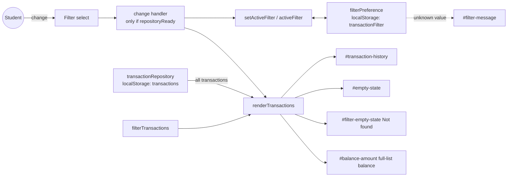

# Architecture: AG-10 - Filter transactions by type

Run ID: AG-10-3 | Branch: feature/AG-10-3 | Revised after Design Review (see "Amendments from Design Review"); approval state is tracked in workflow-session.json, not in this file
Input: `.claude/AgentOutput/AG-10-3/requirements.md` (Stage 1 approved by the user)

## 1. Verified Repository Facts (inspected this run)

- Static front end: `index.html` (108 lines), `script.js` (530 lines, vanilla JS, global scope, no modules), `styles.css`. No `package.json`, no CI, no build.
- `script.js`: `transactionRepository` (load/save, key `transactions`, envelope `{schemaVersion:1, transactions}`), module-level state `transactions`, `repositoryReady`, `isSaving`, `isLoading`. `renderTransactions(nextTransactions, balanceInPaise)` rebuilds `#transaction-history` (`aria-live="polite"`), sets balance, and toggles `#empty-state` (`hidden`) when the list is empty. `loadTransactions()` and the form `submit` handler both call `renderTransactions`. `renderLoadFailure` hides empty state and history.
- Balance is computed by `calculateAvailableBalance(all transactions)` before each render, independent of what is displayed.
- `index.html`: history section contains `#load-error`, `#retry-load`, `#empty-state` ("No transactions yet. Add one to get started."), `#transaction-history`. The type field already uses a labeled `<select>` inside `.field`.
- `tests/app.test.cjs`: `node:test`, runs `script.js` in `vm` with a hand-written `FakeElement`/`document`/`window`. `getElementById` returns `null` for ids not in its fixed list; the storage fake supports `getItem`/`setItem` only (no `removeItem`), with `failReads`/`failWrites` options. `FakeElement.addEventListener` keeps one listener per event name; `dispatch(name)` invokes it. The app test hook exposes selected functions via `globalThis.__appTest`.
- Git: on `feature/AG-10-3` at `a8ed0d6`; only untracked item is the unrelated analytics JSON (must not be touched). `feature/AG-10-1` holds earlier AG-10 work (reference only, per D-7; not consulted for design decisions here).

## 2. Architecture Overview

Pure client-side change to the existing three files plus tests. No new files in the app, no new dependencies, no network. A filter is a UI/view concern layered between the stored transaction list and `renderTransactions`; the repository and the stored `transactions` envelope are untouched (FR-006, NFR-002).

Components:

| # | Component | Status | Responsibility | Reqs |
|---|---|---|---|---|
| C1 | Filter control `<select id="transaction-filter">` with `<label for>` "Show", options All / Income / Expenses (values `all`, `income`, `expenses`), placed in the history section above the list | New (HTML) | FR-001; keyboard-operable, labeled (NFR-001). A select is chosen to match the existing Type control, works in Chrome (NFR-004), and enforces exactly three options. | FR-001, NFR-001 |
| C2 | Filter definitions: `TRANSACTION_FILTERS = { all: null, income: "Money Received", expenses: "Expense" }`, `DEFAULT_FILTER = "all"`, pure `isKnownFilter(v)` and `filterTransactions(list, filter)` | New (JS) | Single source of label-to-stored-type mapping (D-6). Pure and unit-testable. | FR-002, 003, 005, BR-001/002 |
| C3 | Filter preference store `filterPreference` { `read()`, `write(value)` } using `window.localStorage` key `transactionFilter` | New (JS) | Persist/restore selection (D-1, D-10). Isolated from `transactionRepository`; never throws to callers (see section 4). | FR-007, FR-010 |
| C4 | View state `activeFilter` (module variable, default `"all"`), `lastBalanceInPaise` (balance of the full list from the last successful render) and `setActiveFilter(value, {persist})` | New (JS) | `setActiveFilter` only updates `activeFilter`, syncs C1 `value`, and persists via C3. It never renders and never throws. Callers render. (F-2) | FR-002, 003, 007 |
| C5 | `renderTransactions` | Modified | Receives full list + full-list balance; renders `filterTransactions(all, activeFilter)`; shows `#empty-state` whenever the whole history is empty (any filter, F-4); sets `#filter-empty-state` text to "Not found" only when history is non-empty and the filtered list is empty, otherwise clears it. Balance always from the full list. | FR-004, 006, 008 |
| C6 | `#filter-empty-state` permanent `
`, always present, not `hidden`, empty by default | New (HTML) | FR-008 message: `textContent` = "Not found" to show, "" to hide (F-3). Separate from the existing "No transactions yet" message so existing behavior and tests stay intact. | FR-004, 008 |
| C7 | `#filter-message` permanent `
`, always present, not `hidden`, empty by default | New (HTML) | FR-010 message: `textContent` = "unknown value" to show, "" to hide (F-3). | FR-010 |
| C8 | Startup and `loadTransactions` | Modified | The filter preference is read once at startup, before the first `loadTransactions()`, and is not re-read on Retry (F-5). On load failure the existing error state is unchanged and takes precedence; the select is disabled until a load succeeds (F-1). | FR-007, edge cases |
| C9 | Submit handler | Modified | After a successful save, and after `transactions = updatedTransactions`, if `activeFilter` would hide the new transaction call `setActiveFilter("all")`, then run the existing guarded `renderTransactions`. No reset when save fails (F-2). | FR-009 |
| C13 | `change` handler on C1 | New (JS) | Reads `filterSelect.value`; if `!repositoryReady` do nothing to the view; otherwise `setActiveFilter` then render the current `transactions` with `lastBalanceInPaise` inside try/catch (F-1, F-2). | FR-002, 003 |
| C10 | Styles for `.filter` row and messages | Modified (CSS) | Minimal; reuse `.field` styling. | NFR-003 |
| C11 | Tests | Modified | See section 7. | all AC |

Component diagram:

## 3. Data Flow

1. Startup (once): `filterPreference.read()` returns `{ value, unknown }` -> `activeFilter = unknown ? "all" : value`; select synced; `#filter-message` text set to "unknown value" if `unknown`. Then `loadTransactions()` -> `transactionRepository.load()` (unchanged) -> `calculateAvailableBalance(all)` -> `renderTransactions(all, balance)`; `lastBalanceInPaise` stored; select enabled. Retry calls `loadTransactions()` only and does not re-read the preference (F-5).
2. User changes filter: `change` event -> if `!repositoryReady`, ignore (no render, balance and empty state untouched) -> read `filterSelect.value`; `isKnownFilter` -> `setActiveFilter` (best-effort persist) -> `renderTransactions(transactions, lastBalanceInPaise)` in try/catch; `#filter-message` cleared because a valid selection was made. No balance recomputation on this path, so no `RangeError` can escape the handler.
3. Add transaction: validation and save unchanged. After `transactionRepository.save` succeeds and `transactions = updatedTransactions`, if `activeFilter !== "all"` and the new transaction's type does not match, `setActiveFilter("all")` (persists "all"); then the existing guarded `renderTransactions(transactions, updatedBalance)` runs once and updates `lastBalanceInPaise`. `#save-status` shows "Transaction added." as today. If save fails, the filter is not reset.
4. Render: list = `filterTransactions(all, activeFilter)`; whole history empty -> `#empty-state` ("No transactions yet") for every filter and `#filter-empty-state` is cleared; non-empty history and empty filtered list -> `#filter-empty-state` text "Not found" and no items.

Balance is computed from the full list in every path (FR-006, AC-005); filtering never calls `save`.

## 4. Filter State and Persistence Design (resolves Stage 2 open items)

- Storage key: `transactionFilter` (separate from `transactions`; ASSUMPTION AS-1 for the name). Stored value: the plain string `all`, `income`, or `expenses` (no JSON envelope; ASSUMPTION AS-2). Stored values are internal ids, not display labels.
- Default: no stored value (`getItem` returns `null`) -> `all`, no message (AC-006).
- Unknown value (any other string): treated as invalid per BR-002/D-4. `#filter-message` text is set to `unknown value` (an empty-string stored value is also unknown, F-5) (exact casing from D-9), the list displayed is All (ASSUMPTION A-7, now an explicit design choice), the select shows All. The invalid stored value is overwritten with `all` on a best-effort basis so the message does not repeat on every reload; the message stays visible for the current page view until the user picks a filter (ASSUMPTION AS-3). Also covers a `change` event carrying an unknown value (defensive; also fall back to All with the message).
- Storage unavailable (property access throws, `getItem` throws, or `setItem` throws/quota): the filter works in memory for the session, default All, no crash, no blocking error, and no "unknown value" message (storage failure is not an unknown value). The failure is swallowed inside C3 (it never throws) and no visible notice is shown (AS-4). It must not alter the existing load-error flow, since the filter is non-critical.
- Order of precedence on load: if `transactionRepository.load()` fails, the existing load-failure UI is shown and the filter message/empty messages are not shown (existing behavior preserved). The select stays visible but is disabled by `renderLoadFailure` and re-enabled after a successful load, and the `change` handler does nothing unless `repositoryReady` (F-1; supersedes the earlier "inert" wording of AS-5).
- Concurrency: single page, synchronous storage; multi-tab sync is not required (Not Applicable, last write wins).

## 5. Message and Accessibility Design

- Texts: `Not found` (D-2/D-11) and `unknown value` (D-9) used exactly as given by the user.
- NFR-001: label bound via `for`; native select is keyboard-operable. The filtered list is rendered into `#transaction-history` (`aria-live="polite"`), so changes are announced. `#filter-empty-state` and `#filter-message` are permanent `role="status"` containers that are always in the DOM and never `hidden`; their `textContent` is changed to show or clear the message, so announcements are more reliable (F-3, AS-6). No CSS `display` rule may hide them or conflict with this (F-7). Announcement is verified manually in Chrome only; report as not run unless executed.
- All dynamic text is set through `textContent` (existing convention); no `innerHTML`.

## 6. Integration Points and Impact

| File | Change |
|---|---|
| `index.html` | Add filter label/select, `#filter-empty-state`, `#filter-message` inside the history section. Existing ids unchanged. |
| `script.js` | Add C2, C3, C4; modify `renderTransactions`, `loadTransactions`, submit handler; add `change` listener. `transactionRepository`, validation, balance, and money functions unchanged. Expose new pure helpers through the test hook is done in the test file's `vm` snippet, not in app code. |
| `styles.css` | Small additions for the filter row and message paragraphs. |
| `tests/app.test.cjs` | Add new ids to the fake DOM id list and HTML presence test; add filter tests. |

Regression notes: `renderTransactions` signature is kept (two arguments); existing tests that look at `#empty-state` and history items continue to apply with the default All filter. Adding ids to the fake DOM is required because `getElementById` returns `null` for unknown ids; the app code should still guard nulls like the existing `if (transactionForm)` pattern for the new elements.

## 7. Test Approach (node:test + existing fake DOM; no new tooling)

Automated (run with `node --test tests/`):
- Pure: `filterTransactions` for all/income/expenses on mixed data; mapping Income = `Money Received` (AC-002, AC-003).
- HTML: select has exactly three options with the expected values/labels and an associated label (AC-001); new ids present.
- Render: filter income/expenses shows only matching items; All restores full list (AC-002/003); no matches -> "Not found" visible and zero items (AC-004, AC-007); empty history + All, Income or Expenses -> "No transactions yet" visible, "Not found" empty (F-4).
- Load failure (`failReads`): select disabled; dispatching a filter change leaves `#empty-state` and `#balance-amount` hidden (F-1).
- Save failure (`failWrites` on `transactions`) with a hiding filter active: filter is not reset (F-2).
- Startup restore only: Retry does not re-read the preference (F-5).
- Fake DOM constraints (F-6): app code reads `filterSelect.value` (not `event.target`), uses `hidden`/`textContent` (not `classList.add/contains`), null-guards new elements, and never calls `removeItem`. Tests add the three new ids (`transaction-filter`, `filter-empty-state`, `filter-message`) to both id lists and assert observable DOM state, not `activeFilter`.
- Balance unchanged after filtering (AC-005).
- Persistence: default All with empty storage; select Income, then recreate the app with the same storage -> Income restored (AC-006).
- Add while hidden: filter Income, add Expense -> filter resets to All, stored value `all`, new item visible (AC-008).
- Unknown stored value (e.g. `bogus`) -> "unknown value" visible, All displayed (AC-009).
- Storage failures: `failReads`/`failWrites` for the preference path -> no throw, filter still works in session, no visible notice; load-error precedence preserved. Note the fake storage fails all keys under `failReads`, so a preference-only failure needs a small fake-storage option to fail just `transactionFilter`.
- Security/data: stored `transactions` envelope byte-identical before/after filtering.
Manual (Chrome only, NFR-004): keyboard operation and screen-reader announcement; not automatable with the fake DOM. These are reported as manual/not-run unless executed.

## 8. Security, Failure, Scalability

- Security boundary: the only new untrusted input is the `transactionFilter` localStorage value and the select value; both are validated against a closed allow-list and never used as HTML or object keys without `Object.hasOwn`/allow-list checking (avoid `__proto__`-style keys). No network, secrets, or new dependencies.
- Failure scenarios covered: unknown value, storage unreadable/unwritable, load failure, filter hides new transaction, empty history. Rendering failure after save keeps the existing error text.
- Scalability: O(n) in-memory filter per render; same order of cost as existing full re-render. No performance target specified (NFR-003).

## 9. Technology Decisions and Alternatives

- Select vs radio group vs button group: select chosen (consistency with existing Type field, least markup, native a11y); alternatives not pursued.
- Separate `#filter-empty-state` vs reusing `#empty-state` with swapped text: separate chosen to keep the existing empty message and tests untouched.
- Separate localStorage item vs embedding filter into the `transactions` envelope: separate chosen to avoid a schema-version change and to keep NFR-002.
- Clean implementation (D-7); AG-10-1 code is not copied.

## 10. Risks

| ID | Risk | Mitigation |
|---|---|---|
| R-1 | Second storage item adds failure modes | Isolated C3, never throws, tested with failing storage |
| R-2 | "Not found" vs "No transactions yet" confusion | Distinct elements, tested for both cases |
| R-3 | Fake DOM lacks new ids / `removeItem` | Extend id list; avoid `removeItem` (overwrite with `all`) |
| R-4 | Unknown-value message visibility depends on assumed behavior AS-3 | Flagged for user confirmation |
| R-5 | No CI exists; only `node --test` and manual Chrome | Report manual checks honestly |
| R-6 | Unrelated untracked analytics JSON | Keep untracked; stage files by explicit path only |

## 11. Requirements Traceability

| Req | Component(s) | Test (section 7) |
|---|---|---|
| FR-001 / AC-001 | C1 | HTML test |
| FR-002 / AC-002 | C1, C2, C4, C5 | Render + pure tests |
| FR-003 / AC-003 | C2, C4, C5 | Render test |
| FR-004, FR-008 / AC-004, AC-007 | C5, C6 | No-match render test |
| FR-005 | C2 | Mapping test |
| FR-006 / AC-005 | C5 (full-list balance), repository untouched | Balance + storage-unchanged tests |
| FR-007 / AC-006 | C3, C4, C8 | Persistence test |
| FR-009 / AC-008 | C9 | Add-while-hidden test |
| FR-010 / AC-009 | C3, C7, C8 | Unknown-value test |
| NFR-001 | C1, C6, C7 | HTML + manual |
| NFR-002 | C3 separate from repository | Storage-unchanged test |
| NFR-003 | Section 9 | Test conventions |
| NFR-004 | Native select | Manual Chrome |

## 12. Design Assumptions and Open Questions

Design choices taken as the defaults proposed in this document:

- AS-1 Key name `transactionFilter`; AS-2 plain-string values `all|income|expenses`.
- AS-3 On unknown stored value: show "unknown value", display All, overwrite stored value with `all`; message persists until the next user selection.
- AS-4 Storage unavailable: silent in-memory fallback, default All, no visible notice.
- AS-5 On repository load failure the filter control stays visible but no filter/empty message is shown.
- AS-6 The two new message elements are permanent `role="status"` containers (see amendments).
- Control type: `<select>`. Add-while-hidden reset: no extra feedback beyond "Transaction added.".

The user's Stage 2 decision message was "use the defaults and APPROVE", relayed by the coordinator; it accepts the defaults above.

Open questions: none.

## 13. Amendments from Design Review

Source: `design-review.md` (verdict approve-with-changes). The coordinator relayed these user decisions: F-4 and F-3 as stated below. The remaining findings are incorporated as design guidance per the coordinator's instruction.

- F-1: A filter change never renders unless `repositoryReady`; the select is disabled while load has failed and enabled after a successful load (C8, C13, section 3 step 2, section 4, tests).
- F-2: State and persistence are split from rendering: `setActiveFilter` never renders or throws (C4). The add-flow reset happens after `transactions` is assigned and before the existing guarded render; no reset when save fails (C9). Balance source for the `change` path is `lastBalanceInPaise` (C4, C13).
- F-3: User decision: `#filter-empty-state` and `#filter-message` are permanent `role="status"` containers whose content is updated (not un-hidden) (C6, C7, section 5).
- F-4: User decision: when the whole history is empty, show "No transactions yet" even with a non-All filter; "Not found" only when the history is non-empty and the filter matches none (C5, section 3 step 4, tests). This interprets AC-007 as applying to a non-empty history.
- F-5: The preference is read once at startup, not on Retry; an empty-string stored value is unknown (C8, section 4).
- F-6: Fake DOM constraints are binding on app and test code (section 7).
- F-7: Header status text updated; no `display` rules on the message elements (section 5).

## 14. Approval Status

Approval state and evidence are recorded in `workflow-session.json` by the orchestrator. This document claims no approval.
