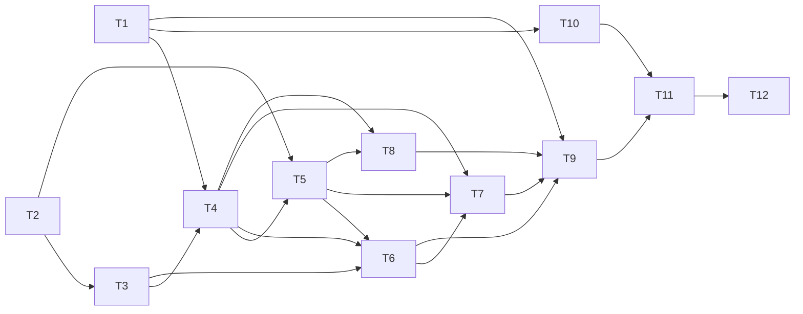

# Implementation Plan: AG-10 - Filter transactions by type

Run ID: AG-10-3 | Branch: feature/AG-10-3 | Stage 4 status: AWAITING HUMAN APPROVAL (approval state and evidence are recorded only in workflow-session.json; this file claims no approval)
Inputs: `requirements.md` (Stage 1), `architecture.md` including section 13 "Amendments from Design Review" (Stage 2), `design-review.md` (Stage 3). Stages 1-3 are recorded as approved in workflow-session.json. Stage 5 is not approved.

## 1. Repository Facts Verified for Planning (read this run)

- Git: branch `feature/AG-10-3`. `git status --short`: modified `.claude/AgentOutput/AG-10-3/workflow-session.json`; untracked `architecture.md`, `design-review.md`, and `docs/codemie/analytics/codemie-analytics-shivkant-kumar-epam-com-5be63969-0378-4a0d-840b-ff537e47839a.json`. No `package.json`, no CI. Tests run with `node --test tests/` (not executed in this stage).
- `script.js` (530 lines): constants at lines 1-4; element lookups at 261-281; state `transactions`, `repositoryReady`, `isSaving`, `isLoading` at 289-292; `showElement` at 294; `renderTransactions` 387-398; `renderLoadFailure` 400-412; `loadTransactions` 414-436 (calls `renderTransactions` before assigning `transactions`); submit handler 449-524 (`transactions = updatedTransactions` at 507, guarded render at 510-518); Retry listener 526-528 (`loadTransactions` is also invoked once at startup, location to be confirmed by the implementer with Grep before editing; it is not in the lines read).
- `index.html` (108 lines): history section lines 94-104 (`#load-error`, `#retry-load`, `#empty-state` `hidden`, `#transaction-history` `aria-live="polite"`). Type control uses `.field` + `<label for>` + `<select>`.
- `styles.css` (202 lines): `.field`, `.field select` rules exist (lines 69-96); `#empty-state` rule at 125 sets only margin/color (no `display`); `.hide {display:none}` at 183.
- `tests/app.test.cjs` (462 lines): `createApp` id list lines 115-132; vm hook snippet lines 152-162; `createStorage` lines 95-112 (`getItem`/`setItem` only, `failReads`/`failWrites` apply to every key); HTML id list lines 174-191; `FakeElement.dispatch` passes an event with no `target`; `classList` implements only `toggle`.
- Existing tests that must keep passing unchanged: lines 173-461 (e.g. load-failure tests expect `#empty-state` hidden and `#balance-amount` hidden; empty app expects `#empty-state` visible).

## 2. Files Expected to Change

| File | Change |
|---|---|
| `index.html` | Add filter label/select, `#filter-empty-state`, `#filter-message` inside the history section |
| `script.js` | C2, C3, C4, C13 additions; modify `renderTransactions`, `renderLoadFailure`, `loadTransactions` (enable select on success), submit handler; startup preference read |
| `styles.css` | Small additions for the filter row and the two message paragraphs (no `display` rules on them) |
| `tests/app.test.cjs` | Extend fake DOM ids, storage fake, HTML test, vm hook; add filter tests |
| `.claude/AgentOutput/AG-10-3/implementation-notes.md` | Created in Stage 5 (workflow artifact, not application code) |

No other files. No new app files, no dependencies.

## 3. Working-Tree Items to Avoid

- `docs/codemie/analytics/codemie-analytics-shivkant-kumar-epam-com-5be63969-0378-4a0d-840b-ff537e47839a.json` is unrelated and untracked: do not edit, delete, or stage it. Stage by explicit file path only; never `git add -A`/`git add .`.
- `workflow-session.json`, `architecture.md`, `design-review.md` have uncommitted orchestrator changes: the implementation agent must not edit them (orchestrator owns session state).
- `feature/AG-10-1` code is reference only (D-7); do not cherry-pick or copy.
- Do not touch `transactionRepository`, validation, money functions, or the `transactions` storage key/envelope.

## 4. Tasks (dependency ordered)

Priority: all are required. Conventions for every task: vanilla JS, `textContent` only (no `innerHTML`), null-guard new elements like `if (transactionForm)`, read `filterSelect.value` (never `event.target`), use `hidden`/`textContent` (never `classList.add/contains`), never call `removeItem`, no `display` CSS on message elements (F-6, F-7).

### T1 - Markup: filter control and permanent message containers
- Depends on: none. File: `index.html`.
- Work: In the history section, above `#empty-state`/list, add a `.field` containing `<label for="transaction-filter">Show</label>` and `<select id="transaction-filter" name="filter">` with exactly three options: `all` "All", `income` "Income", `expenses` "Expenses". Add `

` and `

`, both present, without `hidden`, without text. Keep all existing ids. Select initially `disabled` is optional; T6 manages it (decide one approach and keep consistent: plan default is enabled in HTML, disabled by `renderLoadFailure`).
- Acceptance: three options with the exact values/labels; label associated by `for`; two status paragraphs empty and not hidden; existing ids unchanged.
- Verify: T9 HTML test; open file check.

### T2 - Filter definitions and pure helpers
- Depends on: none (parallel with T1). File: `script.js` (near constants, lines 1-4).
- Work: `TRANSACTION_FILTERS = { all: null, income: "Money Received", expenses: "Expense" }`, `DEFAULT_FILTER = "all"`; `isKnownFilter(value)` using `typeof value === "string" && Object.hasOwn(TRANSACTION_FILTERS, value)`; `filterTransactions(list, filter)` returning the full list for `all`/unknown, else `list.filter(t => t.type === TRANSACTION_FILTERS[filter])`. Derive types from `TRANSACTION_TYPES` only if no change to that array is needed; do not modify it.
- Acceptance: pure, no DOM/storage use; `__proto__`, `constructor`, `toString` are unknown; Income maps to `Money Received`, Expenses to `Expense` (FR-005).
- Verify: T9 pure tests.

### T3 - Filter preference store (C3)
- Depends on: T2. File: `script.js`.
- Work: `filterPreference.read()` returns `{ value, unknown }`: wrap the `window.localStorage` access and `getItem("transactionFilter")` in try/catch; `null` -> `{value:"all", unknown:false}`; known string -> that value; any other string including `""` -> `{value:"all", unknown:true}`; any storage exception -> `{value:"all", unknown:false}`. `write(value)` does `setItem("transactionFilter", value)` in try/catch, never throws, returns nothing meaningful. Reuse the repository's storage-access style where practical but do not modify the repository.
- Acceptance: never throws for property-access, read, or write failures; no `removeItem`.
- Verify: T9 persistence and storage-failure tests.

### T4 - View state and `setActiveFilter` (C4)
- Depends on: T1, T2, T3. File: `script.js` (after element lookups at ~261-281 and state at ~289-292).
- Work: look up `filterSelect`, `filterEmptyState`, `filterMessage` with `document.getElementById`; add `let activeFilter = DEFAULT_FILTER; let lastBalanceInPaise = null;`. `setActiveFilter(value, { persist = true } = {})`: if not `isKnownFilter(value)` use `"all"`; set `activeFilter`; if `filterSelect` then `filterSelect.value = activeFilter`; if `persist` then `filterPreference.write(activeFilter)`. It never renders and never throws.
- Acceptance: no rendering or balance computation inside; safe when `filterSelect` is null.
- Verify: T9 tests (observable select value and storage value).

### T5 - Rendering changes (C5)
- Depends on: T2, T4. File: `script.js` `renderTransactions` (387-398).
- Work: keep the two-argument signature `(nextTransactions, balanceInPaise)`. Render items from `filterTransactions(nextTransactions, activeFilter)`; set balance from the argument (full-list balance, unchanged); `emptyState.hidden = nextTransactions.length !== 0` (whole history, so "No transactions yet" shows for any filter, F-4); set `filterEmptyState.textContent = "Not found"` only when `nextTransactions.length > 0` and the filtered list is empty, else `""`; set `lastBalanceInPaise = balanceInPaise` after the render statements succeed. Null-guard `filterEmptyState`.
- Acceptance: AC-002/003/004/005/007; empty history + any filter shows "No transactions yet" and an empty `#filter-empty-state`; balance never depends on the filter.
- Verify: T9 render, F-4 and balance tests; existing tests 317-461 still pass.

### T6 - Load/startup/failure integration (C8)
- Depends on: T3, T4, T5. File: `script.js` (`renderLoadFailure` 400-412, `loadTransactions` 414-436, startup call site).
- Work: (a) Before the first `loadTransactions()` call, once only: `const stored = filterPreference.read(); setActiveFilter(stored.value, {persist: false});` and if `stored.unknown` set `filterMessage.textContent = "unknown value"` and best-effort overwrite the stored value with `all` via `setActiveFilter("all")` (persist). Not repeated on Retry (F-5). (b) `renderLoadFailure`: set `filterSelect.disabled = true`, clear `filterEmptyState.textContent` and `filterMessage.textContent` so no filter or empty message is shown beside the load error (architecture section 4 precedence; existing hides stay). (c) On successful load in `loadTransactions`, set `filterSelect.disabled = false`.
- Acceptance: load-failure state identical to today plus disabled select; after Retry succeeds the select is enabled and the restored `activeFilter` is applied to the render; Retry does not re-read the preference.
- Verify: T9 F-1, F-5, AC-006, AC-009 tests.
- Noted consequence (design detail, low): clearing `#filter-message` on load failure means an unknown-value message from startup will not reappear after a successful Retry. This follows architecture section 4 ("not shown" on load failure); implementer records it in implementation-notes and does not add new behavior.

### T7 - Change handler (C13)
- Depends on: T4, T5, T6. File: `script.js` (after the submit/Retry listeners).
- Work: `if (filterSelect) filterSelect.addEventListener("change", ...)`. Handler: if `!repositoryReady` return (no state, render, balance or empty-state change). Read `filterSelect.value`; call `setActiveFilter(value)` (unknown falls back to All and sets `filterMessage` to "unknown value"; a known value clears `filterMessage`); then in try/catch call `renderTransactions(transactions, lastBalanceInPaise)`. No balance recomputation and no `save` call on this path. On a render exception, set `formError` via `setFormError` only if consistent with existing patterns; otherwise swallow and leave prior DOM (record choice in implementation-notes).
- Acceptance: AC-002/003; nothing escapes the handler; `lastBalanceInPaise` null cannot occur when `repositoryReady` is true (assert by reading code path).
- Verify: T9 tests.

### T8 - Add-flow reset (C9)
- Depends on: T4, T5. File: `script.js` submit handler (around 507-518).
- Work: immediately after `transactions = updatedTransactions;` and before the existing guarded `try { renderTransactions(...) }`, add: if `activeFilter !== "all"` and `filterTransactions([transaction], activeFilter).length === 0` then `setActiveFilter("all")` and clear `filterMessage`. Do not add reset on the save-failure path (the early `return` at ~504 already precedes it). No extra user feedback beyond "Transaction added." (Stage 2 default). A single render per add.
- Acceptance: AC-008; failed save leaves the filter, stored value, and form unchanged (F-2).
- Verify: T9 add-while-hidden and save-failure tests.

### T9 - Test updates (all in `tests/app.test.cjs`)
- Depends on: T1-T8 for execution; test scaffolding (9a) may be written in parallel with T1. Written test-first where practical, but must run against the final code.
- 9a Scaffolding: add `transaction-filter`, `filter-empty-state`, `filter-message` to the `createApp` id list (lines 115-132) and the HTML presence list (174-191); in `createApp`, initialize `elements["transaction-filter"].value = "all"`; add `filterTransactions`, `isKnownFilter` to the vm hook snippet (152-162); extend `createStorage` with a per-key failure option (for example `options.failKeys`, a Set of keys that throw on read/write) so a preference-only failure can be simulated without breaking existing `failReads`/`failWrites` behavior. Add a small helper to count rendered `.transaction-item` children.
- 9b New tests (names prefixed `integration:`/`unit:` per existing convention):

| Test | Maps to |
|---|---|
| unit: `filterTransactions` all/income/expenses on mixed data; mapping Income = `Money Received`; unknown/prototype keys fall to All via `isKnownFilter` | AC-002, AC-003, FR-005, security |
| integration: HTML has select with exactly three options (values and labels), `<label for>`, and both status paragraphs present, not `hidden`, empty | AC-001, F-3, NFR-001 |
| integration: select Income shows only `Money Received` items; Expenses only `Expense`; All restores full list | AC-002, AC-003 |
| integration: non-empty history, filter with no matches -> `#filter-empty-state` text exactly "Not found", zero items, `#empty-state` hidden | AC-004, AC-007 |
| integration: empty history with All/Income/Expenses -> `#empty-state` visible, `#filter-empty-state` empty | F-4 |
| integration: balance text and stored `transactions` envelope (string) identical before and after filter changes | AC-005, NFR-002 |
| integration: empty storage -> select value `all`, no message; select Income, recreate app with same storage -> Income restored and filtered list shown | AC-006 |
| integration: stored `bogus` and stored `""` -> `#filter-message` "unknown value", All shown, select `all`, stored value overwritten with `all` | AC-009, F-5 |
| integration: filter Income, add an Expense -> select `all`, stored `all`, new item visible, "Transaction added." shown | AC-008 |
| integration: `failWrites` on `transactions` with a hiding filter active (needs load from valid seeded envelope) -> submit fails, filter and stored filter value unchanged | F-2 |
| integration: `failReads` startup -> select disabled; dispatching filter change leaves `#empty-state` hidden, `#balance-amount` hidden, load error intact | F-1 |
| integration: load failure then recovery -> select enabled, restored filter applied; Retry does not re-read the preference (change stored value between failure and Retry; in-memory selection wins) | F-1, F-5 |
| integration: preference-only storage failure (read and write) -> no throw, filter works for the session, default All, no `#filter-message` text | storage-unavailable design, R-1 |
| integration: existing tests unchanged and green | regression |

- Acceptance: new tests assert observable DOM and storage state (not `activeFilter`); no existing test edited except the two id lists and the vm hook; each new test fails if its feature is removed (spot-check by temporarily reasoning/mutation is optional, record if done).

### T10 - Styles
- Depends on: T1. File: `styles.css`.
- Work: minimal rules reusing `.field` look for the filter row inside `.history-card` (margin below the control) and margin/color for `#filter-empty-state` and `#filter-message` mirroring `#empty-state`. No `display` property on those ids (F-7).
- Acceptance: filter select visually matches the Type control; messages unstyled-hidden state is just empty paragraphs (consider `:empty { margin: 0 }` to avoid blank space; optional).
- Verify: manual Chrome check (T12).

### T11 - Automated verification run
- Depends on: T1-T10. Command: `node --test tests/` from the repo root.
- Acceptance: all tests pass with actual output captured in implementation-notes.md; failures are reported, not hidden. Counts of passed/failed/skipped recorded exactly.

### T12 - Manual Chrome checks (NFR-001, NFR-004) and implementation notes
- Depends on: T11. Not automatable with the fake DOM.
- Work: in Chrome, open `index.html`; check keyboard operation of the select, label association, reload persistence, "Not found" and "unknown value" (set `localStorage.transactionFilter="bogus"` in DevTools) display, load-error state (corrupt `transactions`), add-while-hidden. Screen-reader announcement: report as NOT RUN unless actually executed. Write `implementation-notes.md` (files changed, decisions, deviations, tests executed with real results, manual checks run/not run).
- Acceptance: each manual check listed with status Passed/Failed/Not run; no claims without execution.

## 5. Dependency Graph

Suggested execution order: T1, T2, T3, T4, T5, T6, T7, T8, T10, T9, T11, T12. No task is blocked; no open questions remain (architecture section 12).

## 6. Requirement and Finding Coverage

| Item | Tasks | Test |
|---|---|---|
| AC-001 / FR-001 | T1 | HTML test |
| AC-002 / FR-002, FR-005 | T2, T5, T7 | pure + render tests |
| AC-003 / FR-003 | T2, T5, T7 | render test |
| AC-004, AC-007 / FR-004, FR-008 | T1, T5 | no-match test |
| AC-005 / FR-006, NFR-002 | T5, T7 (no save) | balance + envelope test |
| AC-006 / FR-007 | T3, T4, T6 | persistence test |
| AC-008 / FR-009 | T8 | add-while-hidden test |
| AC-009 / FR-010 | T3, T6, T7 | unknown-value test |
| F-1 | T6, T7 | load-failure test |
| F-2 | T4, T7, T8 | save-failure test, single render |
| F-3 | T1, T5, T6 | HTML test; announcement manual (T12) |
| F-4 | T5 | empty-history test |
| F-5 | T6 | Retry and empty-string tests |
| F-6 | all tasks (conventions), T9a | fake DOM compatibility |
| F-7 | T1, T10 | no `display` rules; header text already updated in architecture.md |
| NFR-001, NFR-004 | T1, T12 | manual (Chrome) |
| NFR-003 | all | conventions |

## 7. Risks

| ID | Risk | Mitigation |
|---|---|---|
| PR-1 | Fake storage `failReads`/`failWrites` hit all keys; preference-only failures untestable | T9a per-key failure option, backward compatible |
| PR-2 | `loadTransactions` renders before assigning `transactions`; `lastBalanceInPaise` set in render | Set only in `renderTransactions` after success; change handler guarded by `repositoryReady` |
| PR-3 | Startup call site of `loadTransactions()` not yet inspected in detail (lines 280-300 not read) | Implementer reads before editing; preference read must precede it |
| PR-4 | Unknown-value message lost after load failure then Retry | Accepted per architecture section 4; record in notes |
| PR-5 | Announcement behavior unverifiable in this environment | Report as manual / not run |
| PR-6 | No CI; only local `node --test` | Report actual output only |
| PR-7 | Accidentally staging the analytics JSON | Explicit-path staging only |

Accepted/deferred (not blockers): PR-4, PR-5, PR-6. Decisions needing user approval before implementation: only approval of this plan (Stage 4). Interpretation F-4 (empty history shows "No transactions yet" for any filter) was decided by the user at Stage 3 per workflow-session.json.

## 8. Rollback

- Work happens on `feature/AG-10-3` only; nothing is merged. Undo options before commit: `git restore index.html script.js styles.css tests/app.test.cjs` (affects only those four files; confirm no unrelated changes first). After commit: `git revert <commit>` (no history rewrite). Do not use `git reset --hard`, `git clean`, or force-push.
- Runtime rollback: the feature stores only `transactionFilter` in `localStorage`; the `transactions` data is never modified, so removing the feature leaves user data intact (the extra key is harmless and ignored).

## 9. Commit Grouping (recommendations only; no commit is authorized by this plan)

1. Test scaffolding plus feature tests can land with the code they cover. Suggested split, each commit leaving `node --test tests/` green:
   - C-A: `index.html` + `styles.css` + `script.js` (T1-T8, T10) together with `tests/app.test.cjs` (T9). Because the HTML test and behaviors are coupled, a single feature commit is the safest option.
   - C-B (optional, if the reviewer prefers smaller commits): C-B1 test scaffolding and pure helper (T2 + 9a + pure tests); C-B2 UI, persistence and flows (rest).
2. Artifacts (`requirements.md`, `architecture.md`, `design-review.md`, `impl-plan.md`, `implementation-notes.md`, `workflow-session.json`) in a separate docs commit.
3. Never include the `docs/codemie/analytics/...json`. Stage by explicit path. Before any push, scan the commits for secrets (CLAUDE.md section 16). Commit message footer per the session attribution; commits and push require explicit user authorization.

## 10. Approval Status

Status: AWAITING HUMAN APPROVAL of Stage 4. No approval evidence recorded here. Stage 5 (Implementation) must not start until the user explicitly approves this plan.
