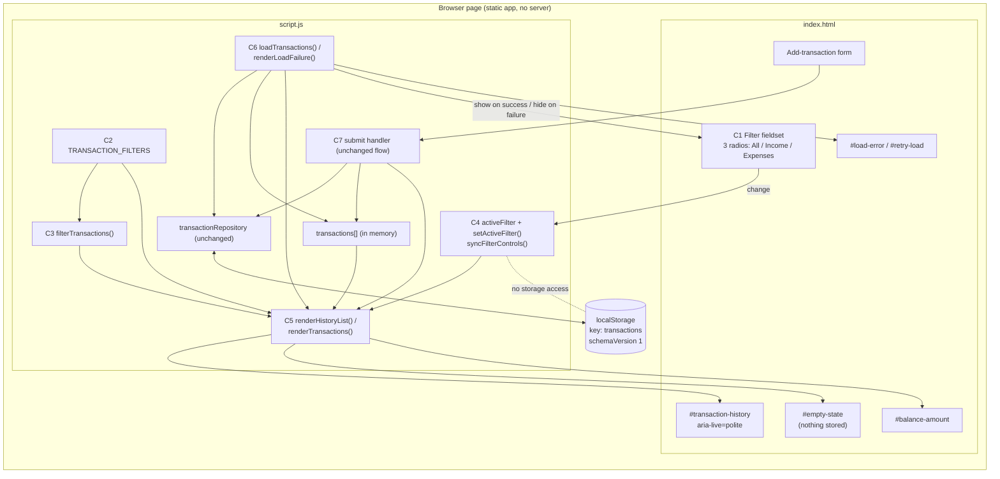
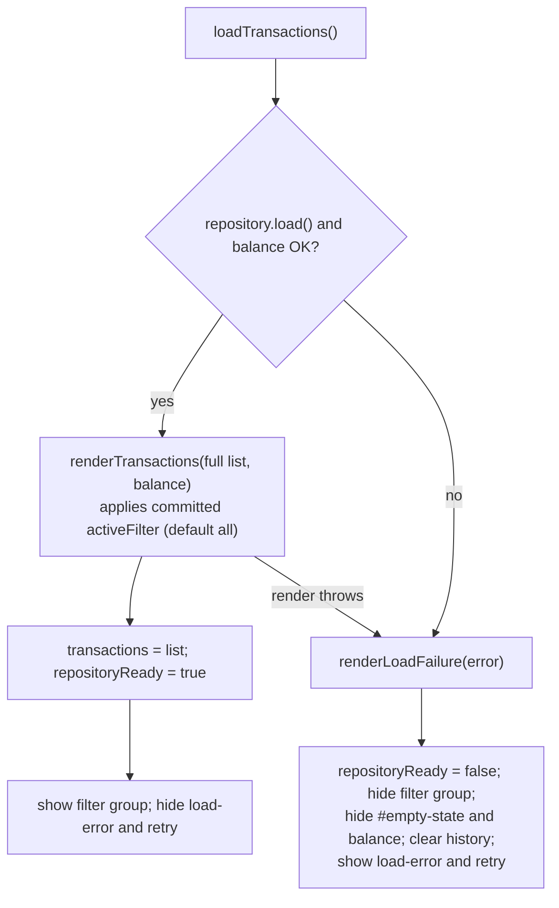

# Architecture: AG-10 - Filter transactions by type

- Run ID: AG-10-4 (branch `feature/AG-10-4`)
- Stage: 2 - Architecture Design
- Input: `requirements.md` revision 2, APPROVED by the user on 2026-11-02 (committed c2a435c)
- Revision: Draft 2 (2026-11-02), amendment of the Stage 2 approved Draft 1 (committed 9b19c82). Draft 1 content is preserved except where tagged `[Draft 2 / P-n]`.
- **Status: APPROVED (Draft 2) - 2026-11-02.** The user approved Draft 1 at Stage 2 ("approve stage 2"; committed 9b19c82). At Stage 3 the user approved applying proposals P-1..P-5 from `design-review.md` (findings DR-001..DR-007) as proposals only. The user then explicitly approved this amended Draft 2 text with the message "approve Draft 2" on 2026-11-02 (relayed by the orchestrator). This approval covers Stage 2 Draft 2 only. It is not approval for Stage 4, any commit, any push, or any pull request; each requires its own explicit human approval.
- No application code was written or changed. Draft 2 edits only this file; `requirements.md`, `design-review.md`, and `workflow-session.json` were not touched by this amendment.

### Amendment note (Draft 2)

Scope: apply Stage 3 proposals P-1..P-5 (resolving DR-001, DR-002, DR-003, DR-004, DR-005, DR-006, DR-007). No requirement (FR/NFR/AC/BR), confirmed decision D-01..D-11, or decision PD-01..PD-04 changes meaning. PD-05 is amended in detail only (see P-2). No ID is renumbered or deleted; R-06 is closed, not removed. Additions are a new Section 11.1 and tags `[Draft 2 / P-n]`.

Approval: Draft 2 was APPROVED by the user on 2026-11-02 (evidence: user message "approve Draft 2", relayed by the orchestrator). Approval covers Stage 2 Draft 2 only (see Section 13).

| Item | Resolves | Where applied |
|---|---|---|
| P-1 | DR-001 | Section 4.1 (C4, C5), Section 4.5 filter-change diagram, PD-04 note, Section 10 |
| P-2 | DR-002 | Section 4.1 (C1, C4), PD-05, Section 11 (markup row), Section 11.1, R-03 |
| P-3 | DR-004 | Section 8 (failure row), R-06 (closed) |
| P-4 | DR-005 | Section 11 (test outline and fake-DOM notes), Section 14.1 |
| P-5 | DR-003, DR-006 | Section 11 (manual row), new Section 11.1, Section 9, Section 12, Section 14 |

DR-006 (arrow-key chatter) and DR-007 (repeated type literals) need no design change: DR-006 folds into the manual checklist and R-01; DR-007 is covered by the existing mandatory coverage test.

## 1. Architecture Overview and Objectives

**Objective.** Add a client-side, view-only filter (All / Income / Expenses) to the existing transaction history of the static "Vidyarthi Khataa" app, with type-specific empty messages, while leaving storage, validation, the balance calculation, and the add-transaction flow unchanged in behavior.

**Approach in one paragraph.** Introduce a single in-memory value, `activeFilter` (default `"all"`), next to the existing in-memory `transactions` array. The visible list is always derived at render time as `filterTransactions(transactions, activeFilter)`; nothing derived is stored. A native radio group in the history card changes `activeFilter` and re-renders only the history list region. The existing `renderTransactions` entry point keeps its contract (receives the full list and the balance) and applies the active filter internally, so the load path and the add-transaction path pick up the filter with no change to their control flow. The load-failure path hides the filter group and never renders a filter message.

**Design principles (all taken from the repository's existing conventions).** No new dependencies; DOM built with `createElement`/`textContent`; visibility through `showElement` (`.hide`) and `hidden`; status through `role`/`aria-live`; labelled controls; 600px breakpoint; integer paise; storage schema untouched.

## 2. Requirements and Constraints (extracted from the approved requirements)

| Area | Summary | IDs |
|---|---|---|
| Control | Labelled, keyboard-operable single-choice control with exactly All, Income, Expenses; default All; control type settled here | FR-001, FR-008, D-02, D-04, AC-001, AC-007, AC-013 |
| Filtering | Income = `Money Received`; Expenses = `Expense`; All = everything; view-only over in-memory data | FR-002..004, FR-006, FR-007, BR-001, BR-002, BR-004, D-01 |
| Empty messages | "No income transactions found." / "No expense transactions found." when transactions exist but none match; existing "No transactions yet. Add one to get started." only when nothing is stored | FR-005, FR-010, D-03, AC-004..006 |
| Add flow | Keep active filter; save, update balance, show "Transaction added."; hide non-matching new item | FR-011, D-05, AC-009 |
| Balance | Always reflects all transactions | FR-012, D-06, AC-008 |
| Load failure | Existing load-error state wins; filter hidden or disabled (settled here); no "no matches" message | FR-013, D-07, AC-012 |
| Persistence | None; resets to All on reload; no storage or schema change | FR-008, D-08, AC-007, AC-008 |
| Presentation | Visible items keep format and relative order | FR-009, AC-010 |
| NFR | Accessibility via existing live region, `textContent`, 600px layout, no new deps, client-side performance, no off-device data | NFR-001..006, D-09 |
| Out of scope | Count of matches (D-10), documentation (D-11), other criteria, sort/search/pagination, changes to add/validate/store/migrate | D-10, D-11 |

## 3. Existing System Context (verified by inspection in this stage)

All items below were read from the files on branch `feature/AG-10-4`; line numbers refer to the current files.

| Fact | Evidence |
|---|---|
| Static app: `index.html`, `script.js`, `styles.css`; vanilla JS, no modules, no bundler. `package.json`, `.github` CI, README: Not Found. Only `docs/codemie/analytics/*.json` exist under `docs/`. | File listing |
| Tests: `tests/app.test.cjs`, `node:test` + `node:vm` with a hand-written fake DOM. Baseline executed in this stage: `node --test tests/` on Node v20.17.0 gave 15 tests, 15 pass, 0 fail, 0 skipped. | Command run in this stage |
| Types: `TRANSACTION_TYPES = ["Expense", "Money Received"]`; `isStoredTransaction` rejects any other type, so every loaded record has exactly one of the two types. | `script.js` lines 3, 116-124 |
| Persistence: `localStorage` key `transactions`, envelope `{schemaVersion: 1, transactions}`; only `transactionRepository.load()` and `.save()` touch storage. `load()` may write once (legacy migration). | `script.js` lines 204-259 |
| Module-level state: `transactions` (array), `repositoryReady`, `isSaving`, `isLoading`. | `script.js` lines 289-292 |
| `showElement(el, visible)` toggles the `hide` class and is null-tolerant. | `script.js` lines 294-298 |
| `renderTransactions(nextTransactions, balanceInPaise)`: builds the list element first (so a render error occurs before any DOM mutation), then `transactionHistory.replaceChildren(list)`, sets the balance text and un-hides it, and sets `emptyState.hidden = nextTransactions.length !== 0`. | `script.js` lines 387-398 |
| `renderLoadFailure(error)`: sets `repositoryReady=false`, disables save, hides balance and `#empty-state`, clears the history, writes `#load-error`, shows it and the retry button. | `script.js` lines 400-412 |
| `loadTransactions()`: load, compute balance, render, then assign `transactions`, set `repositoryReady`, enable save, hide load-error/retry; any throw goes to `renderLoadFailure`. Called on retry click and once at start-up. | `script.js` lines 414-436, 526-530 |
| Submit handler: guards on `isSaving/isLoading/!repositoryReady`; validates; builds `updatedTransactions` and `updatedBalance` from the full list; saves; assigns `transactions`; `form.reset()`; `renderTransactions(transactions, updatedBalance)`; sets "Transaction added."; a render failure after a successful save shows a form error. | `script.js` lines 449-524 |
| History markup: `section.history-card` containing `h2#history-heading`, `p#load-error[role=alert]`, `button#retry-load`, `p#empty-state[hidden]` with the "No transactions yet..." text, and `div#transaction-history[aria-live=polite]`. **`#empty-state` is a sibling of, not inside, the `aria-live` region.** | `index.html` lines 94-104 |
| Existing form select is labelled with `<label for>`; there is no `fieldset`/`legend`, radio input, or `autocomplete="off"` on a radio anywhere. | `index.html` |
| CSS: `.hide {display:none}` is declared near the end of the file (line 183), after the component rules, and is the same specificity as single-class rules; one `@media (max-width: 600px)` block; inputs use `min-height: 2.75rem`; muted text colour `#5c6678`. | `styles.css` |
| Fake DOM (`FakeElement`): supports `addEventListener` (one listener per event name per element), `dispatch(name)` (event has only `preventDefault`; no `target`), `setAttribute/removeAttribute`, `append`, `replaceChildren`, `textContent`, `value`, `disabled`, `hidden`, and `classList.toggle` only (no `add`/`remove`/`contains`). Elements are served by `document.getElementById` from a fixed id list; unknown ids return `null`. `querySelector`, `closest`, event delegation, radio-group exclusivity: Not Found. | `tests/app.test.cjs` lines 24-93, 114-168 |
| The test harness exposes internals by appending a snippet inside the same `vm` script, so top-level `const`/`let` of `script.js` are reachable from that snippet. | `tests/app.test.cjs` lines 152-165 |
| Content-Security-Policy meta/header: Not Found. | `index.html` |
| Git: branch `feature/AG-10-4`; only untracked item is `.claude/AgentOutput/AG-10-4/workflow-session.json`. | `git status` |

## 4. Proposed Architecture

### 4.1 Components

Existing components that remain unchanged in behavior: `transactionRepository`, `validateTransaction`, `calculateAvailableBalance`, `formatINR`, `formatTransactionDate`, `createTransactionElement`, `createTransactionId`, the add-transaction form and its submit-handler control flow.

| # | Component | Kind | Responsibility | Inputs / outputs | Depends on |
|---|---|---|---|---|---|
| C1 | History filter markup | New (`index.html`) | A `fieldset.history-filter` with a `legend` ("Filter by type") holding three native radio inputs (`name="history-filter"`, ids `filter-all`, `filter-income`, `filter-expenses`, values `all`/`income`/`expenses`), each with an explicit `<label for>` reading All / Income / Expenses. The All radio carries `checked`; radios may carry `autocomplete="off"` as a best-effort hint only (`[Draft 2 / P-2]`: not mandated, not asserted by tests; see PD-05). The fieldset ships with the `hide` class (revealed by script only after a successful load). Placed directly under `#history-heading`. Not inside `#transaction-form`. | User selection in; `change` events out | None |
| C2 | Filter definition | New (`script.js`) | One constant `TRANSACTION_FILTERS` mapping each key to its stored type and empty message: `all` -> no type restriction, no message; `income` -> `Money Received`, "No income transactions found."; `expenses` -> `Expense`, "No expense transactions found.". It is the only place where the Income/Expenses to stored-type mapping (D-01, BR-004) and the filter messages (D-03) are defined. | Read by C3, C4 | `TRANSACTION_TYPES` (for tests to assert coverage) |
| C3 | Filter predicate | New pure function `filterTransactions(list, filterKey)` | Returns a new array containing the items whose `type` matches the filter's type, in original order; `all` returns every item; an unknown key behaves as `all` (BR-003). Never mutates its input, never reads the DOM or storage. | In: array, key. Out: new array | C2 |
| C4 | View state and control binding | New (`script.js`) | Holds `let activeFilter = "all"` (in-memory only). `setActiveFilter(key)` normalizes the key (unknown -> `all`), calls `renderHistoryList(transactions, key)` (C5) with that candidate key explicitly, then commits `activeFilter = key` and calls `syncFilterControls()` (`[Draft 2 / P-1]`). `syncFilterControls()` projects `activeFilter` onto the three radios by setting `checked` explicitly on each. Start-up wiring attaches one `change` listener per radio, each bound by closure to its own key (not read from `event.target` or the DOM `value`); the listener does nothing when `!repositoryReady`. Start-up also calls `syncFilterControls()` once, and **optionally** registers a second sync on `pageshow`, only when `typeof window.addEventListener === "function"` (the test harness `window` stub has no `addEventListener`; an unguarded call would crash start-up in every test) (`[Draft 2 / P-2]`). | In: radio `change` events. Out: calls to C5; radio `checked` projection | C2, C5, `repositoryReady` |
| C5 | History renderer | Changed (`script.js`) | Split of today's `renderTransactions`: **`renderHistoryList(allTransactions, filterKey = activeFilter)`** builds the visible view from `allTransactions` and `filterKey`, then updates `#transaction-history` and `#empty-state` (decision table in 4.3). The `filterKey` parameter defaults to the committed `activeFilter`; the filter-change path passes the candidate key explicitly so the render can happen before the state is committed (`[Draft 2 / P-1]`). **`renderTransactions(allTransactions, balanceInPaise)`** keeps its signature and call sites: it calls `renderHistoryList(allTransactions)` (default key, i.e. the committed `activeFilter`) and then sets/unhides the balance exactly as today. **Contract note (`[Draft 2 / P-1]`):** `renderTransactions` applies the active filter internally, so its `allTransactions` argument must always be the **full** list, never a pre-filtered one; passing a subset would also corrupt the empty-state decision (stored count) and, for callers that derive the balance from the same list, the balance. The filter-change path calls only `renderHistoryList`, so the balance DOM is never touched by a filter change. All list/message elements are built before any DOM mutation (preserves today's atomicity). | In: full list (+ balance), optional filter key. Out: DOM | C3, C2, `createTransactionElement` |
| C6 | Load lifecycle hook | Changed (`script.js`) | `renderLoadFailure` additionally hides C1 (`showElement(filter, false)`); `loadTransactions` success path additionally shows C1 after `repositoryReady = true`. No other change to either function. | Existing flow | C1, `showElement` |
| C7 | Add-transaction flow | Unchanged control flow | Continues to call `renderTransactions(transactions, updatedBalance)` with the full list; the filter is applied inside C5 (D-05 follows without new code in the handler). | Existing | C5 |
| C8 | Styles | Changed (`styles.css`) | Rules for `.history-filter` (reset fieldset border/padding/min-width, margin below), its `legend`, an inner `.filter-options` flex row with `flex-wrap: wrap`, option labels with `min-height: 2.75rem` touch height, and the in-list empty message (shares the muted colour with `#empty-state`). Native radio focus ring is kept. Must not set `display` on the fieldset itself (see Section 9, R-04). New rules go before the `.hide` rule. A rule inside the existing 600px media block only if inspection shows wrapping is insufficient. | n/a | None |
| C9 | Tests | Changed (`tests/app.test.cjs`) | Fake DOM id list and required-controls test extended with the four new ids; the fake filter element is created with `className = "hide"` to mirror the shipped markup (`[Draft 2 / P-4]`); the harness snippet exports the new pure function/constant; new tests per Section 11. | n/a | C1..C6 |

### 4.2 State model

| State | Owner | Lifetime | Source of truth for |
|---|---|---|---|
| `transactions` (existing) | `script.js` | Page session; reloaded from storage | Full history; balance |
| `activeFilter` (new) | `script.js` | Page session only; initial `"all"`; never written to storage, URL, or cookies | Which subset is displayed |
| Radio `checked` flags | DOM | Derived projection | None; always overwritten from `activeFilter` by `syncFilterControls()` |
| Visible list | DOM | Derived on every render | None; never stored |

### 4.3 Render decision table (`renderHistoryList`)

| Stored count | Visible count | `#empty-state` | `#transaction-history` content |
|---|---|---|---|
| 0 | 0 | shown (`hidden=false`), existing text | existing behaviour (empty list container); the filter is ignored for messaging, so the "Add one to get started" prompt shows under every option (FR-010, AC-006) |
| > 0 | 0 (filter `income` or `expenses`) | hidden | a single message paragraph (class `empty-message`) with that filter's message, **instead of** the list (FR-005, AC-004, AC-005) |
| > 0 | > 0 | hidden | `div.transaction-list` with the matching items in original order (FR-002..004, FR-009) |

Because exactly one branch runs per render, the two kinds of empty message can never appear together (FR-010).

### 4.4 Component diagram



### 4.5 Data-flow diagrams

**Filter change**

```mermaid
sequenceDiagram
  actor U as Student
  participant R as Radio (change)
  participant S as setActiveFilter
  participant P as filterTransactions
  participant H as renderHistoryList
  participant D as DOM (#transaction-history, #empty-state)
  U->>R: choose Income / Expenses / All
  R->>S: key bound by closure
  alt repositoryReady is false
    S-->>R: ignore (no render, no message)
  else ready
    S->>S: normalize key (unknown -> all)
    S->>H: renderHistoryList(transactions, key) with the candidate key (full list)
    H->>P: filterTransactions(transactions, key)
    P-->>H: new array (original order)
    H->>D: list, or empty-filter message, or existing empty-state
    S->>S: commit activeFilter = key, syncFilterControls()
  end
  Note over S,D: No storage read or write. Balance DOM untouched. If the render throws, the exception propagates; activeFilter is not committed.
```

**Add transaction under an active filter (D-05)**

```mermaid
sequenceDiagram
  actor U as Student
  participant F as Submit handler (existing)
  participant Repo as transactionRepository
  participant T as transactions[]
  participant R as renderTransactions
  U->>F: submit valid transaction
  F->>F: build updatedTransactions and updatedBalance from the FULL list
  F->>Repo: save(updatedTransactions)
  alt save fails
    F-->>U: existing form error; nothing changes
  else saved
    F->>T: transactions = updatedTransactions
    F->>R: renderTransactions(transactions, updatedBalance)
    R->>R: renderHistoryList(full list) applies committed activeFilter by default (unchanged selection)
    R->>R: set balance from full list
    F-->>U: "Transaction added." (item shown only if it matches)
  end
```

**Load / retry, success and failure (D-07)**



## 5. Proposed Decisions

PD-01 to PD-05 were proposed in Draft 1 and became approved decisions on the user's Stage 2 approval of 2026-11-02 (see Section 13). The decision text for PD-01 to PD-04 is unchanged in meaning from Draft 1 (PD-04 carries one clarifying note, `[Draft 2 / P-1]`). PD-05 is amended in detail by `[Draft 2 / P-2]`; the amended PD-05 text was **approved** with Draft 2 on 2026-11-02.

### PD-01 - Control type: native radio group (confirms the user's lean)

- **Proposal.** Use a `fieldset`/`legend` containing three native `input type="radio"` elements with explicit `<label for>`.
- **Rationale.**
  1. All three options are visible at once, which serves the story goal ("quickly review one kind") with one interaction per switch instead of open-select-choose.
  2. Native radios give a programmatic group label (`legend`), single-choice semantics, and arrow-key/Space operation with no custom ARIA or key handling, satisfying FR-001, NFR-001, AC-013 and D-04.
  3. A `change` event fires only on the radio that becomes checked, so the handler needs no extra logic.
  4. Three short labels wrap cleanly with `flex-wrap`, so the 600px requirement (NFR-003) needs little or no extra CSS.
  5. The radios sit outside `#transaction-form`, so `form.reset()` cannot affect them.
- **Rejected alternatives.**
  - Labelled `<select>`: matches the existing form's control, but hides the options behind a click, and the existing `.field select` styles are scoped to the form. Acceptable per D-04, rejected for usability.
  - Buttons with `aria-pressed` or a `role="tablist"`: needs custom ARIA, roving tabindex, and key handling; more JS and more a11y risk for no benefit; not testable with the current fake DOM without extra support.
  - Radios visually restyled as a segmented control: still a native radio underneath, so it is a styling choice rather than an architectural alternative; deferred to implementation and permitted if the native focus indicator is kept.

### PD-02 - Load failure: hide the filter (do not disable it)

- **Proposal.** On load failure, hide the filter fieldset using the existing `showElement(filter, false)` helper (`hide` class). Show it again only after a successful load. Add a defensive guard so that a filter change while `repositoryReady` is false does nothing (no state change, no render, no message). On load failure the history container is cleared and no filter message is ever created, so the existing `#load-error` state is the only history-area content.
- **Rationale.**
  1. FR-013/D-07 require the load-error to take precedence and storage failure never to look like an empty history. A visible but disabled control still advertises a working "history", and a disabled "All" radio would appear selected over nothing.
  2. Hiding removes the control from the tab order and the accessibility tree, so there is no inert focus stop or confusing disabled announcement.
  3. It mirrors what `renderLoadFailure` already does to the balance and `#empty-state` (hidden), keeping one consistent failure presentation.
  4. `showElement` is already used and is supported by the fake DOM (`classList.toggle`), so it is testable (`className` contains `hide`).
  5. The control is not hidden when the load succeeds with zero stored transactions: AC-006 requires "No transactions yet..." under every option, which presupposes a visible filter.
- **Rejected alternatives.**
  - Disable the radios (`disabled`): leaves a dead control visible and potentially announced; risks looking like valid state; needs re-enabling logic of the same size as show/hide.
  - Keep enabled and show a different message: violates D-07.
  - Use the `hidden` attribute instead of the `hide` class: `hidden` is overridden by any author `display` rule on the same element, a silent failure. The `hide` class plus the rule "never set `display` on the fieldset" is safer (R-04).
- **Guard note.** The handler guard is defense in depth; a hidden control cannot normally be operated. It also makes the behavior testable by dispatching `change` after a failed load.

### PD-03 - Filter empty messages live inside the existing live region

- **Finding.** `#empty-state` is outside the `aria-live` region (`index.html` lines 100-103). Changing its text or `hidden` flag is therefore not reliably announced, while AC-013/NFR-001 require list or empty-message changes caused by the filter to be announced via the existing live region.
- **Proposal.** Render the two filter-specific messages as a paragraph built with `createElement`/`textContent` and placed **inside** `#transaction-history` (replacing the list), so the existing `aria-live="polite"` region announces them. Leave `#empty-state` and its text exactly as is for the "nothing stored" case (it is not a filter-result change). The `#transaction-history` element and its `aria-live` attribute are not modified.
- **Rationale.** Inserting content into an always-rendered live region is the most reliable announcement path; it reuses the existing region as D-09 requires; it keeps the "nothing stored" behaviour and existing tests untouched.
- **Rejected alternatives.**
  - Reuse `#empty-state` with dynamic text: not inside the live region, announcement unreliable; also a hidden-to-visible toggle with simultaneous text change is a known weak announcement path.
  - Move `#empty-state` inside the live region: `replaceChildren` on `#transaction-history` would delete it, and it alters existing markup and tests.
  - Add `role="status"` to `#empty-state`: toggling `hidden` on a live region is unreliable, and it creates a second live region.
  - Add a separate screen-reader-only announcement (such as "3 income transactions"): would be a count, which D-10 rules out.

### PD-04 - Derive the view at render time; keep `renderTransactions` signature

- **Proposal.** `transactions` remains the only copy of the data. The filtered subset is computed inside `renderHistoryList` on every render. `renderTransactions(allTransactions, balanceInPaise)` keeps its signature and both call sites; callers continue to compute the balance from the full list (FR-012, D-06). Filter changes call `renderHistoryList` only.
- **Clarification (`[Draft 2 / P-1]`, no change of meaning).** `renderHistoryList(allTransactions, filterKey = activeFilter)` takes the filter key as a defaulted parameter: `renderTransactions` uses the default; the filter-change path passes the candidate key so it can render before committing state. Because `renderTransactions` applies the filter itself, every caller must pass the full list.
- **Rationale.** Smallest change to existing flows; D-05 holds without touching the submit handler; the balance cannot be affected by a filter change because balance code is not on that path; no derived state to drift.
- **Rejected alternatives.**
  - Store a `filteredTransactions` array: duplicate state that can go stale after adds/reloads.
  - Hide/show existing item elements with CSS or a class: leaves non-matching nodes in the DOM and in the live region, cannot produce the empty message cleanly, and needs per-item tagging.
  - Change `renderTransactions` to accept the visible subset from callers: pushes filtering into every caller and risks computing the balance from the subset.
  - Persist the filter or encode it in the URL: out of scope (D-08).

### PD-05 - State is the source of truth for the radios; mitigate browser form-state restoration (amended, `[Draft 2 / P-2]`, approved with Draft 2 on 2026-11-02)

- **Proposal.** At start-up, and on every `setActiveFilter`, call `syncFilterControls()` so the radios' `checked` flags are always overwritten from `activeFilter` (all three set explicitly). Markup ships with All `checked`. **Amended:** `autocomplete="off"` on the radios is a **best-effort** hint, not a mandated element of the design and not a test assertion: the HTML specification may not define `autocomplete` for `type="radio"` (this was not confirmed against browser behavior in this stage), so its effect and any validator noise are **Not Verified**; the implementation may include or omit it, and the explicit state-driven sync is the actual mechanism. **Optionally**, the implementation may add a second `syncFilterControls()` call from a `pageshow` listener (covers restoration or back/forward-cache restore that happens after start-up). That registration **must be guarded** (`typeof window.addEventListener === "function"`) because the test harness `window` stub has no `addEventListener` and an unguarded call would crash start-up in every test. The reload behavior in real browsers is checked manually at Verification (Section 11.1, item M-2).
- **Rationale.** Browsers may restore form control state after a reload or history navigation, which could leave "Income" visually selected while `activeFilter` is `all` (a violation of AC-007). Explicit projection from state removes the dependency on browser behavior as far as start-up ordering allows. The exact timing of restoration relative to script execution in each browser is **Not Verified** in this stage (see R-03); if a browser restores state after the script runs, start-up sync alone would not help, which is why the optional guarded `pageshow` sync and the manual two-browser reload check exist. The user decided at Stage 3 to keep `autocomplete="off"` as best-effort and to rely on the explicit reload check at Verification.
- **Rejected alternative.** Reading the initial filter from the checked radio: reintroduces the restoration problem and implicitly persists state, contradicting D-08.

## 6. Technology Choices and Rationale

| Concern | Choice | Rationale | Alternatives considered |
|---|---|---|---|
| Language/runtime | Existing vanilla JS, no modules (NFR-004) | Repository convention; tests load `script.js` source into `vm` | Introducing a framework or bundler: rejected, violates NFR-004 and the test harness model |
| Control | Native radio group (PD-01) | See PD-01 | `select`, ARIA buttons/tabs |
| Filtering | Pure array filter by stored type, O(n) per render (NFR-005) | Trivially testable, no new state; history is bounded by localStorage size and already re-rendered fully on each add | Indexing/caching by type: unnecessary, no performance target (D-09) |
| State | Module-level `let activeFilter` | Same pattern as `transactions`/`repositoryReady` | Persisting to storage/URL: out of scope (D-08) |
| DOM building | `createElement` + `textContent` | Existing convention; NFR-002 | `innerHTML`/templates: rejected for XSS risk |
| Visibility | `showElement` (`hide` class) for the filter; `hidden` for the existing `#empty-state` and balance | Follows existing conventions; avoids the `hidden`/`display` override trap | n/a |
| Styling | Plain CSS in `styles.css`; existing colour palette and spacing | NFR-003 | CSS framework: rejected |
| Tests | Existing `node:test` + `vm` fake DOM | NFR-004 | Browser E2E tooling: Not Found in repo, would add dependencies |

New dependencies: none.

## 7. Security and Privacy

| Concern | Treatment | IDs |
|---|---|---|
| XSS | Notes, types, amounts, dates and the two new messages are all set via `textContent`; no `innerHTML`. Filter keys are internal constants, never taken from user text, URL, or storage. The new markup is static. | NFR-002, AC-011 |
| Data integrity | The filter path performs no `localStorage` access (no `getItem`, no `setItem`); `filterTransactions` returns a new array and does not mutate records. | FR-007, BR-002, AC-008 |
| Privacy | No network calls, no logging, no analytics; selection is not stored in storage, cookies or URL. | NFR-006, D-08 |
| Trust boundary | The only external input to this feature is a user click on one of three internal-valued radios. Unknown keys normalize to All (BR-003). Stored data is still validated by the existing `isStoredTransaction`. | BR-003 |
| Secrets | None involved. This document contains none. | - |
| CSP | Not Found (no policy configured); not introduced by this change. | - |

## 8. Error Handling and Failure Scenarios

| Scenario | Behavior | IDs |
|---|---|---|
| Storage unreadable, corrupt, or invalid legacy data (initial load or retry) | Existing `renderLoadFailure`: load-error + retry shown, balance, `#empty-state` and history cleared, save disabled; **filter hidden**; no filter message created. Retry success re-shows the filter and renders with the in-memory `activeFilter` (unchanged because the control was unreachable). | FR-013, AC-012, D-07 |
| Filter change while `repositoryReady` is false | Ignored (guard) | FR-013, AC-012 |
| Stored count 0 | Existing message, shown under every option; no filter message | FR-010, AC-006 |
| Transactions exist, selected type has none | Type-specific message only; no "Add one..." prompt | FR-005, FR-010, AC-005 |
| Add transaction under a filter, non-matching | Saved, balance updated, "Transaction added." shown, item not visible, selection unchanged | FR-011, AC-009 |
| Add transaction under a filter whose list was empty, matching | Message replaced by the list containing the new item | FR-011 |
| Save failure | Existing form error; `transactions`, selection and storage untouched | existing |
| Render failure after successful save | Existing "saved, but the history could not refresh" form error; filter state unaffected | existing |
| Unexpected render exception during a filter change (not reachable with validated data: records are validated at load, `formatINR`/`formatTransactionDate` are safe for validated values) | `[Draft 2 / P-3]` No special handling. Because list/message elements are built before DOM mutation, the previous list stays; `activeFilter` is not committed because the commit follows the render; the exception propagates as it would elsewhere in the app. There is deliberately **no** revert branch and **no** call to `renderLoadFailure`: the case is unreachable with validated data, and `renderLoadFailure` would set `repositoryReady = false`, disable saving, hide the balance, and show the load-error message and retry button, misreporting an in-memory render bug as a storage failure. Residual (accepted as unreachable, not mitigated): in that hypothetical case the clicked radio could show a selection that differs from the unchanged list until the next change. R-06 is closed. | NFR-002 |
| Unknown filter key | Normalized to All | BR-003 |
| Repeated switching | Each render replaces the container's children, so there are no stale or duplicated items | Requirements Section 8 |

## 9. Accessibility

- **Label and operation.** `fieldset`/`legend` names the group; each radio has a `<label for>`; native arrow-key, Tab, and Space behavior; native focus indicator retained (the existing translucent outline style is not reused for radios). Touch target height `2.75rem`, matching existing inputs. (NFR-001, AC-013, FR-001)
- **Announcements.** The list and the filter-specific empty messages are rendered inside `#transaction-history` (`aria-live="polite"`), so changes caused by the filter are announced there (PD-03). The "Transaction added." status continues to use `#save-status` (`role="status"`). Known trade-off: replacing the list re-announces the visible items (existing behavior on add; no count or summary is added because D-10 excludes counts).
- **Visibility.** The filter is removed from the accessibility tree on load failure (PD-02).
- **Responsive.** Options wrap in a flex row; verified manually at 600px and below at Verification (NFR-003). This is a manual-evidence item (Section 11.1, M-4).
- **Manual-evidence items (`[Draft 2 / P-5]`).** Real announcements (AC-013, NFR-001), keyboard operation in a real browser, and the 600px layout cannot be evidenced by the fake DOM; see Section 11.1. Arrow-key traversal fires a `change` per step, so moving across the group re-renders the live region at each step (DR-006); this is covered by R-01 and the manual checklist, with no design change.
- **Language/semantics.** Labels are plain text; `lang="en"` already set.

## 10. Dependencies and Integration Points

| Dependency | Nature | Change |
|---|---|---|
| `TRANSACTION_TYPES`, `isStoredTransaction` | Guarantees every record has exactly one of two types | None |
| `transactionRepository` / `localStorage` | Source of data on load | None; the feature does not call it |
| `calculateAvailableBalance` | Balance from the full list | None; never called with a filtered list |
| `renderTransactions` / `renderHistoryList` | Render entry points | `[Draft 2 / P-1]` `renderTransactions` keeps its signature and must receive the full list; `renderHistoryList(allTransactions, filterKey = activeFilter)` is new |
| `createTransactionElement`, `formatINR`, `formatTransactionDate` | Item presentation | None (FR-009) |
| `showElement`, `renderLoadFailure`, `loadTransactions` | Visibility and lifecycle | Small additions (C6) |
| Submit handler | Add flow | No control-flow change |
| `tests/app.test.cjs` | Existing 15 tests must keep passing | Id list and exports extended (C9) |
| External systems (Jira, network, backend, CI) | Not applicable to the runtime design; no `.github` CI found | None |

## 11. Testability Strategy (outline only; test code belongs to later stages)

**What the fake DOM needs.** Add `history-filter`, `filter-all`, `filter-income`, `filter-expenses` to the id list in `createApp` and the required-controls test. Radios are plain `FakeElement`s: the script sets `.checked` on each (a plain property assignment, supported) and reads nothing from `event.target`; tests trigger `elements["filter-income"].dispatch("change")`. The fake has no radio-group exclusivity, which is why `syncFilterControls()` sets all three flags explicitly. The new code must use only supported APIs (`classList.toggle`, `append`, `replaceChildren`, `textContent`, `hidden`) and be null-tolerant for the new ids, matching the existing `if (transactionForm)` pattern, so a missing id cannot crash start-up. `[Draft 2 / P-4]` The fake filter element is created with `className = "hide"` (mirroring the shipped markup, where the fieldset ships hidden). Otherwise a "filter is visible after a successful load" assertion (`className` does not contain `hide`) would pass even if `showElement(filter, true)` were never called. `[Draft 2 / P-2]` The harness `window` stub has no `addEventListener`; any optional `pageshow` registration must therefore be guarded, and the existing tests running without a crash serve as the check for that guard.

**Exports.** The harness snippet adds `filterTransactions` and `TRANSACTION_FILTERS` for unit tests. `activeFilter` is reachable inside the same `vm` script if a test needs it.

**Test outline (mapped to requirements).**

| Level | Scenario | IDs |
|---|---|---|
| Static/markup | `index.html` has the fieldset, legend, three radios with labels exactly All/Income/Expenses, All `checked`, `name` shared, filter outside the form, filter initially `hide`; the text "No transactions yet. Add one to get started." exists in `#empty-state` markup. `autocomplete="off"` is **not** asserted (best-effort per PD-05, `[Draft 2 / P-2]`) | FR-001, AC-001, AC-013, FR-008 |
| Unit | `filterTransactions`: income only, expenses only, all, empty input, order preserved, input not mutated, unknown key -> all | FR-002..004, FR-009, BR-003, AC-002, AC-003, AC-010 |
| Unit | Every member of `TRANSACTION_TYPES` is covered by exactly one non-all filter | FR-006, BR-001, BR-004, D-01 |
| Integration | Default after load: All checked, full history, filter visible (fake filter starts with `hide`, so visibility is asserted as `hide` removed by script); with empty storage the filter is visible and `#empty-state.hidden === false` (the message text itself is covered by the markup row, because the fake `#empty-state` has empty `textContent`) | FR-004, FR-008, AC-007, AC-006 |
| Integration | Select Income/Expenses via `change`: only matching items rendered; switch back to All restores everything; repeated switching has no duplicates | AC-002, AC-003 |
| Integration | Only expenses stored + Income: "No income transactions found.", no articles, `#empty-state.hidden === true`; mirror case. The "Add one to get started" prompt is asserted through `#empty-state.hidden`, **not** through absent text (the fake `#empty-state.textContent` is always `""`, so an absent-text check would pass vacuously) (`[Draft 2 / P-4]`) | FR-005, FR-010, AC-004, AC-005 |
| Integration | Message is inside `#transaction-history` (found through `collectText(history)`) | PD-03, NFR-001, AC-013 |
| Integration | Storage write spy (added in the test: the `createStorage` helper exposes `values` but no call counter): zero `setItem` calls and unchanged envelope after filter changes; balance text unchanged | FR-007, FR-012, AC-008, D-06 |
| Integration | Under Income, add an expense: saved (envelope count +1), balance updated, "Transaction added.", selection unchanged, item not visible; add an income: visible | FR-011, AC-009, D-05 |
| Integration | Corrupt storage and read failure: filter has `hide`, no filter message, load-error governs; `change` dispatched during failure does nothing; retry success shows the filter again | FR-013, AC-012, D-07 |
| Integration | Markup-like note under a filter rendered as text, no `img` tag | NFR-002, AC-011 |
| Integration | State-not-persisted check: a new `createApp` (a fresh `vm` context) on the same storage starts at All after a previous app had Income selected. This proves only that the selection is not stored; it does **not** prove that a browser reload resets the radio (that is manual item M-2) (`[Draft 2 / P-4]`) | D-08, AC-007 (state part only) |
| Regression | Existing 15 tests unchanged in intent and still pass | NFR-004 |
| Manual (Verification stage; not automatable here) | Real-browser check of keyboard operation, screen-reader announcement of the empty message, 600px layout, and reload behavior (form-state restoration, R-03); checklist in Section 11.1 (`[Draft 2 / P-5]`) | NFR-001, NFR-003, AC-007 (reload), AC-013 |

Coverage limit to state honestly at Verification: the fake DOM cannot prove real announcements, real CSS, or real browser restoration; those are manual checks.

### 11.1 Manual verification checklist (`[Draft 2 / P-5]`)

**Evidence rule.** AC-007 (reload part), AC-013, NFR-001 (announcements) and NFR-003 (600px) are **manual-evidence items**. The user decided at Stage 3 that the user or a reviewer will run these browser checks at Verification. Until a person supplies a result, each must be reported as **Not Run (manual)**, never as passed (CLAUDE.md section 10). If a browser or screen reader is unavailable, report that as the blocker.

| # | Check | Requirement IDs | Pass condition |
|---|---|---|---|
| M-1 | Keyboard: Tab to the group, arrow keys and Space change the selection; focus indicator visible; labels read All / Income / Expenses with the group name | FR-001, NFR-001, AC-013 | Selection and list change by keyboard alone; focus visible |
| M-2 | Reload in two browsers (Firefox and a Chromium-based browser): select Income, reload the page (normal reload and, if practical, back/forward navigation) | AC-007, D-08, R-03 | After reload the All radio is checked **and** the full list is shown; control and list never disagree. Any mismatch in either browser is a failure to report, not to ignore. This is also the evidence for whether `autocomplete="off"` helps |
| M-3 | Screen reader: switch to a filter with no matches, and between filters | AC-013, NFR-001, AC-004, AC-005 | The list or empty message change is announced through the existing live region; note any arrow-key chatter (DR-006, accepted under R-01 unless unusable) |
| M-4 | Narrow viewport at 600px and below | NFR-003 | Options wrap without overflow or clipped labels; touch height is adequate |
## 12. Risks, Trade-offs, and Assumptions

| ID | Item | Type | Mitigation / disposition |
|---|---|---|---|
| R-01 | Live-region re-announcement of the whole list on every filter change (verbose for long histories) | Trade-off | Accepted: existing behavior on add; no count/summary allowed by D-10; D-09 sets no further target |
| R-02 | Screen-reader behavior of in-region empty message cannot be proven by the fake DOM | Risk | Manual check M-3 at Verification (Section 11.1); reported as Not Run (manual) unless a person supplies a result; PD-03 chooses the most reliable insertion pattern |
| R-03 | Browser restoration of radio state on reload could desync control and list (Not Verified here) | Risk | `[Draft 2 / P-2]` PD-05 (explicit state-driven sync at start-up and on change; optional guarded `pageshow` re-sync; `autocomplete="off"` best-effort only); explicit two-browser reload check M-2 (Firefox and a Chromium-based browser) at Verification, reported as Not Run (manual) if no browser is available. Disposition: deferred to Verification (DR-002) |
| R-04 | `hidden` attribute or `.hide` class can be overridden by author `display` rules on the same element | Risk | Use `hide` class, place new CSS before `.hide`, and never set `display` on the fieldset; put flex on the inner `.filter-options` |
| R-05 | Edits to `renderTransactions` could regress balance, empty-state, or atomicity | Risk | Keep signature and call order; filter-change path excludes balance; existing 15 tests plus new regression cases |
| R-06 | The defensive "revert and show load failure" on unexpected render error adds a branch that is practically unreachable | Trade-off | **CLOSED (`[Draft 2 / P-3]`, DR-004).** The branch is dropped from the design. Rationale: it is unreachable with validated data, and `renderLoadFailure` would misreport an in-memory render bug as a storage failure (disabling save, hiding the balance). See Section 8. No requirement is affected |
| R-07 | Retry success keeps `activeFilter` (not reset to All); not specified by the requirements | Assumption (A-S2) | Behavior is consistent because the hidden control could not change during failure; reviewer to confirm |
| R-08 | After a successful retry the retry button is hidden, which may drop keyboard focus | Pre-existing | Out of scope, unchanged |
| A-S1 | Legend wording "Filter by type" is a presentation choice, not a requirement; the three option labels are fixed by D-02 | Assumption | Low impact |
| A-S2 | See R-07 | Assumption | See R-07 |
| A-S3 | Document order places the filter directly under the history heading, above the load-error | Assumption | Cosmetic; can change at implementation without architectural effect |
| A-S4 | No performance target applies (D-09); O(n) filtering per render is adequate for localStorage-sized histories | Assumption | Consistent with D-09 |

Accepted-risk status: assumptions A-S1 to A-S4 and R-07 are confirmed by the user's Stage 2 approval of 2026-11-02 (see Section 13). The approval message did not separately name any other risk as accepted; R-01 to R-05 and R-08 keep the mitigation or disposition stated in the table above, and R-06 is closed by Draft 2 (P-3), approved with Draft 2 on 2026-11-02.

`[Draft 2 / P-5]` Evidence limitation (DR-003): AC-007 (reload part), AC-013 and NFR-001 (announcements) and NFR-003 (600px) have no automated evidence and are manual-evidence items. The user decided at Stage 3 that the user or a reviewer will run them at Verification (Section 11.1). Without a supplied result they are reported as Not Run (manual), not passed. DR-006 (arrow-key re-announcement) is covered by R-01 and check M-3; DR-007 (type literals repeated in three places) keeps the mandatory coverage unit test and needs no design change. These dispositions were accepted with the user's approval of Draft 2 on 2026-11-02.

## 13. Approval Status, Proposed Decisions, and Unresolved Questions

**Approved decisions (Draft 1, approved by the user on 2026-11-02 at Stage 2; this is the historical record):** PD-01 radio group; PD-02 hide filter on load failure; PD-03 empty messages inside the live region; PD-04 derive view at render time and keep `renderTransactions` signature; PD-05 state-driven radio sync with `autocomplete="off"`.

**Draft 2 amendment status (`[Draft 2 / P-1..P-5]`):** PD-05 is amended (`autocomplete="off"` becomes best-effort; optional guarded `pageshow` re-sync; explicit manual reload check). PD-01 to PD-04 keep their approved meaning (PD-04 gained a clarifying note only). The amended text, including the amended PD-05, R-03, R-06 closure, and Section 11/11.1, is **APPROVED** by the user on 2026-11-02 ("approve Draft 2"). The user approved P-1..P-5 as proposals at Stage 3 and made these decisions: keep `autocomplete="off"` as best-effort with an explicit two-browser reload check at Verification; the user or a reviewer runs the manual browser checks (AC-007 reload, AC-013 and NFR-001 announcements, NFR-003 at 600px).

The two decisions the requirements explicitly left to this stage are **PD-01 (radio group)** and **PD-02 (hide, not disable)**. PD-03 to PD-05 are design details found necessary while meeting the approved requirements; none adds a functional requirement or changes a confirmed decision.

**Confirmed assumptions:** A-S1 to A-S4 and R-07 (Section 12) are confirmed by the user's Stage 2 approval of 2026-11-02 (Draft 1) and remain confirmed. The assumptions touched by the amendment (A-S1..A-S4, R-07, and the P-2 treatment of `autocomplete="off"` as best-effort, the optional guarded `pageshow` sync, and the manual-evidence dispositions in Section 11.1 and Section 12) are confirmed by the user's approval of Draft 2 on 2026-11-02.

**Design-review dispositions recorded at Draft 2 approval:**
- DR-012 (residual radio/list mismatch after a render exception during a filter change): accepted as unreachable with validated data; no extra guard is added. No design change.
- DR-011 and DR-014: carried into the Stage 4 implementation plan; they are not addressed in this document.

**Unresolved questions:** None requiring user input to proceed.

**Not done:** no code, no test changes, no commit, no push, no PR, no change to `workflow-session.json`.

**Approval scope:** the Draft 1 approval covered Stage 2 Draft 1 only. The Draft 2 approval covers Stage 2 Draft 2 only. Neither is approval for Stage 4, any commit, any push, or any pull request; each requires its own explicit human approval.

- Draft 1 approval status: **APPROVED** (historical, unchanged)
- Draft 1 approval evidence: user message "approve stage 2", given in reply to the Stage 2 report and relayed by the orchestrator
- Draft 1 approval date: 2026-11-02 (committed 9b19c82)
- **Draft 2 (amended) approval status: APPROVED.**
- Draft 2 approval evidence: user message "approve Draft 2", relayed by the orchestrator
- Draft 2 approval date: 2026-11-02

## 14. Requirements-to-Components Traceability

### 14.1 Functional requirements

| ID | Components / decisions | Verified by (test outline) |
|---|---|---|
| FR-001 | C1, C8, PD-01 | Markup test; manual keyboard check |
| FR-002 | C2, C3, C5 | Unit filter (income); integration select Income |
| FR-003 | C2, C3, C5 | Unit filter (expenses); integration select Expenses |
| FR-004 | C3, C5 | Unit filter (all); integration back to All |
| FR-005 | C2, C5, PD-03 | Empty-message integration (both cases) |
| FR-006 | C2, C3 | Type-coverage unit test |
| FR-007 | C3, C4, C5 (no repository call), PD-04 | Write-spy test; no-mutation unit test |
| FR-008 | C1 (`checked`), C4 (`activeFilter="all"`, no persistence), PD-05 | Default test and state-not-persisted test (re-created app); markup test; manual reload check M-2 |
| FR-009 | C3 (order), C5 (reuses `createTransactionElement`) | Order/presentation tests |
| FR-010 | C5 decision table (single branch per render) | Both-message exclusivity tests |
| FR-011 | C5 via unchanged C7, PD-04 | Add-under-filter tests |
| FR-012 | C5 (`renderHistoryList` excludes balance), PD-04 | Balance-unchanged test |
| FR-013 | C6, C4 guard, PD-02 | Load-failure tests |

### 14.2 Non-functional requirements

| ID | Components / decisions |
|---|---|
| NFR-001 | C1 (fieldset/legend/labels), PD-03 (in-region message), PD-02 (accessibility tree), Section 9; manual-evidence items M-1, M-3 (Section 11.1) |
| NFR-002 | C5 (`textContent`), Section 7 |
| NFR-003 | C8, PD-01 (wrap), manual 600px check M-4 (Section 11.1) |
| NFR-004 | Section 6 (no deps), C9 (existing suite kept) |
| NFR-005 | C3 (client-side O(n)), PD-04 |
| NFR-006 | Section 7 (no network/logging/storage) |

### 14.3 Acceptance criteria

| ID | Components / decisions |
|---|---|
| AC-001 | C1, PD-01 |
| AC-002 | C2, C3, C5 |
| AC-003 | C3, C5 |
| AC-004 | C5, PD-03 |
| AC-005 | C2, C5, PD-03 |
| AC-006 | C5 decision table, C1 filter stays visible on empty history |
| AC-007 | C1, C4, PD-05; reload part is manual evidence M-2 (Section 11.1) |
| AC-008 | C4, C5 (no storage, no balance on filter path), PD-04 |
| AC-009 | C5 via C7, PD-04 |
| AC-010 | C3, C5 |
| AC-011 | C5 (`textContent`), Section 7 |
| AC-012 | C6, C4 guard, PD-02 |
| AC-013 | C1, PD-01, PD-03, Section 9; announcements and keyboard in a real browser are manual evidence M-1, M-3 (Section 11.1) |

### 14.4 Business rules

| ID | Components / decisions |
|---|---|
| BR-001 | C2 and C3 (each record falls in exactly one non-all bucket); validated by existing `isStoredTransaction` |
| BR-002 | C4, C5, PD-04 (view-only) |
| BR-003 | C3 and C4 (normalize unknown key to All) |
| BR-004 | C2 (single mapping definition) |

### 14.5 Confirmed decisions from requirements

| ID | Where honored |
|---|---|
| D-01 | C2, C3 |
| D-02 | C1 (labels All / Income / Expenses) |
| D-03 | C2 messages, C5 decision table, PD-03 |
| D-04 | C1, PD-01, PD-05 (default All) |
| D-05 | C5 via C7, PD-04 |
| D-06 | C5, PD-04 |
| D-07 | C6, PD-02 |
| D-08 | C4 (memory only), PD-05, Section 7 |
| D-09 | Section 9, C8; no extra targets introduced |
| D-10 | Honored by omission: no count anywhere, including screen-reader-only text (PD-03 rejected alternative) |
| D-11 | Honored by omission: no documentation changes planned |

### 14.6 Traceability gaps

- None. Every FR, NFR, AC, BR, and D item above maps to at least one component or decision.
- Observed tension (resolved by PD-03, not a gap): AC-013/NFR-001 ask that empty-message changes be announced via the existing live region, but the existing `#empty-state` sits outside that region. PD-03 resolves it for filter-driven messages; the "nothing stored" message intentionally remains where it is because the filter never changes it.
- Items not verifiable by automated tests (announcement, real CSS at 600px, browser form-state restoration) are listed for manual Verification in Section 11 and the checklist in Section 11.1 so they are not silently dropped; they are reported as Not Run (manual) unless a person supplies a result (`[Draft 2 / P-5]`).

## 15. Revision History

| Revision | Date | Summary |
|---|---|---|
| Draft 1 | 2026-11-02 | Initial architecture draft for AG-10 (run AG-10-4). Proposes PD-01 to PD-05. Awaiting human approval. |
| Draft 1 (approved) | 2026-11-02 | Approval recorded only: status, Section 5 intro, Section 12 accepted-risk note, and Section 13 updated. Approved by user message "approve stage 2" (relayed by the orchestrator); PD-01 to PD-05 approved, A-S1 to A-S4 and R-07 confirmed. Design content, IDs, and traceability unchanged. Covers Stage 2 only. |
| Draft 2 (amendment, APPROVED 2026-11-02) | 2026-11-02 | Amendment of the Stage 2 approved Draft 1 (committed 9b19c82) applying Stage 3 proposals P-1..P-5 (resolving DR-001..DR-007; see `design-review.md`). P-1: `renderHistoryList(allTransactions, filterKey = activeFilter)`, filter-change flow and data-flow text made consistent, full-list contract for `renderTransactions`. P-2: `autocomplete="off"` best-effort and not asserted, optional guarded `pageshow` re-sync, explicit two-browser reload check. P-3: revert-and-`renderLoadFailure` branch dropped, R-06 closed. P-4: test outline tightened (fake filter starts `hide`, `#empty-state.hidden` assertion, state-not-persisted relabel, write-spy note). P-5: manual-evidence items declared, checklist added as Section 11.1. No requirement, D-01..D-11, or PD-01..PD-04 meaning changed; no ID renumbered or deleted. The user approved P-1..P-5 as proposals at Stage 3. Approval of this amended text recorded only (status, Amendment note, Section 5 intro, PD-05 heading, Section 12 notes, Section 13): approved by user message "approve Draft 2" on 2026-11-02 (relayed by the orchestrator); covers Stage 2 Draft 2 only, not Stage 4, push, or PR. DR-012 accepted as unreachable with no extra guard; DR-011 and DR-014 carried into the Stage 4 plan. Design content, IDs, and traceability unchanged. |
