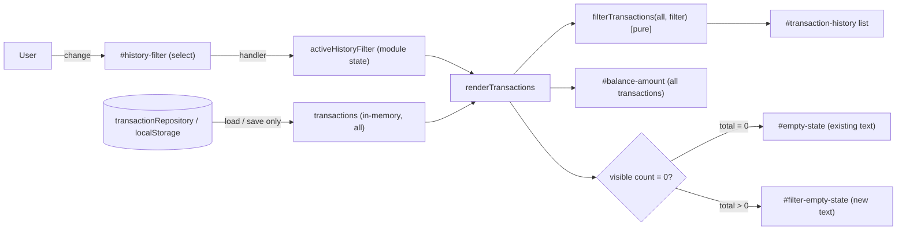

# Architecture: AG-10 Filter transactions by type

- Jira issue: AG-10, run ID AG-10-5, branch `feature/AG-10-5`
- Input: `requirements.md` (Approved by user, 2026-11-03)
- Status: **Approved** (user, 2026-11-03; see section 12). Not committed.

## 1. Verified repository facts (inspected)

- Static app, no framework or build: `index.html`, `script.js` (single classic script, top-level `const`/`let`), `styles.css`. Tests: `tests/app.test.cjs` (`node:test`, fake DOM via `vm`).
- `script.js` structure: pure helpers (`parseAmountToPaise`, `formatINR`, `calculateAvailableBalance`), `transactionRepository` (localStorage load/save, schema v1), DOM element lookups via `getElementById`, module state (`transactions`, `repositoryReady`, `isSaving`, `isLoading`), `createTransactionElement`, `renderTransactions(nextTransactions, balanceInPaise)`, `renderLoadFailure`, `loadTransactions`, submit handler, retry handler.
- `renderTransactions` builds a `.transaction-list`, sets the balance, and sets `emptyState.hidden = nextTransactions.length !== 0`. It is called from `loadTransactions` (initial and retry) and from the submit handler (after save).
- `renderLoadFailure` hides balance and `#empty-state`, clears history, and shows error plus retry.
- The test fake DOM (`FakeElement`) supports `addEventListener`/`dispatch(name)`, `hidden`, `textContent`, `value`, `classList.toggle`, `append`, `replaceChildren`. `getElementById` returns `null` for ids not in the test `ids` list. There is no `querySelector`, `dataset`, or `addEventListener` multi-handler support (one listener per event name).
- Existing styles: `.field select` is already styled; `#empty-state` is styled grey; `.hide` utility exists.
- CI configuration: Not Found.

## 2. Architecture overview

A view-layer-only change. Stored data, the repository, the schema, and balance logic are untouched. A single piece of in-memory UI state (the active filter) is applied inside the render path, so every existing re-render trigger (load, retry, add) automatically honours the filter.

Data-flow notes:
1. Load/retry/add produce the full `transactions` array exactly as today; filtering happens only at render time (FR-5).
2. Balance is computed from the full array and passed to render unchanged (FR-6).
3. The filter control never calls the repository.

## 3. Components and responsibilities

| Component | Status | Responsibility | Requirements |
|-----------|--------|----------------|--------------|
| `index.html`: filter control inside `.history-card`, plus `#filter-empty-state` paragraph | Proposed (new markup) | Present the options All/Income/Expenses; host filter-specific empty message | FR-1, FR-4, FR-7, NFR-1 |
| `script.js`: `HISTORY_FILTERS` constant map | Proposed | Single source of truth mapping filter value to label-independent rule: `all -> null`, `income -> "Money Received"`, `expenses -> "Expense"`, plus empty message strings | FR-2, FR-3, FR-4 |
| `script.js`: `filterTransactions(list, filterKey)` pure function | Proposed | Return the matching subset without mutating or reordering; unknown key falls back to All | FR-2, FR-3, FR-5, A-9 |
| `script.js`: `activeHistoryFilter` state (default `"all"`) | Proposed | Hold current selection in memory only | FR-7, FR-8, A-7 |
| `script.js`: `renderTransactions` | Modified | Apply the filter to the list; compute empty-message visibility; keep balance from the full set | FR-2..FR-6, NFR-4 |
| `script.js`: filter `change` handler | Proposed | Update state; if `repositoryReady`, re-render from in-memory `transactions` (recompute balance via `calculateAvailableBalance`); ignore otherwise | AC-2, AC-3, NFR-4 |
| `script.js`: `renderLoadFailure` | Modified (small) | Also hide `#filter-empty-state` and the filter control (or disable it) | NFR-4 |
| `script.js`: submit handler | Unchanged logic | Already re-renders via `renderTransactions`, which now applies the active filter | FR-8 |
| `transactionRepository`, `calculateAvailableBalance`, validators | Unchanged | Persistence and balance | FR-5, FR-6 |
| `styles.css` | Modified (small) | Layout for the filter row; style `#filter-empty-state` like `#empty-state`; reuse `.field select` look | NFR-3 |
| `tests/app.test.cjs` | Modified | Add new ids to `createApp` and the markup test; add AC tests | NFR-5 |

## 4. Interfaces

- DOM contract (proposed ids): `#history-filter` (select, options `value="all"|"income"|"expenses"`, text "All"/"Income"/"Expenses", `all` selected by default, associated `<label for="history-filter">` e.g. "Show"), `#filter-empty-state` (`hidden` by default).
- Internal function contracts: `filterTransactions(transactions, filterKey) -> Transaction[]` (pure); `renderTransactions(allTransactions, balanceInPaise)` keeps its existing signature and reads `activeHistoryFilter`. Keeping the signature means the existing call sites and tests are unaffected.
- Render rules:
  - total = 0: show `#empty-state` (existing text), hide `#filter-empty-state`, regardless of filter (FR-4 separation).
  - total > 0, visible = 0: hide `#empty-state`; set `#filter-empty-state.textContent` to "No income transactions." or "No expense transactions." and show it. (All can never yield visible = 0 when total > 0.)
  - visible > 0: hide both.
- Test seam: `filterTransactions` and the constants may be added to the `__appTest` export list in `createApp` (test-side change only).

## 5. Technology choices and alternatives

| Decision | Proposed | Rationale | Alternatives (not chosen) |
|----------|----------|-----------|---------------------------|
| Control type (A-8) | Native `<select>` | Matches the existing Type `<select>` and `.field select` styling; free keyboard and screen-reader support; label association is trivial; smallest markup and CSS; works with the fake DOM via `value`/`change` | Radio group / segmented buttons: better one-tap discoverability for 3 options and visible state, but needs fieldset/legend, `aria-pressed` or radio wiring, more CSS, and the fake DOM lacks `querySelectorAll`/`checked` so tests are heavier. Tabs: wrong semantics (no tab panels). |
| State handling | Module-level `let activeHistoryFilter`, applied inside `renderTransactions` | Matches the existing module-state pattern; every render path honours the filter; no new store | Filtering at each call site (duplication, risk of missed path); storing the filtered list as state (risk of divergence from `transactions`); persisting in localStorage/URL (out of scope, A-7). |
| Where to filter | At render time on the in-memory array | Keeps storage and `transactions` authoritative (FR-5); no extra I/O | Re-reading storage on every change (unnecessary, adds failure modes). |
| Filter keys | Internal keys (`all`/`income`/`expenses`) mapped to stored types in one constant | Decouples UI vocabulary from stored data and isolates the R-1 mismatch in one tested place | Using stored type strings as option values (leaks "Money Received" vs "Income" mismatch into markup). |
| Empty message | Separate element `#filter-empty-state` | Preserves the existing `#empty-state` element and text and its tests; easy to assert independently | Reusing `#empty-state` with swapped text (couples two meanings, risks breaking existing assertions and the "no empty message on load failure" rule). |
| Dependencies | None added | NFR-3 | - |

## 6. Security, error handling, accessibility

- Security (NFR-2): all new text is set through `textContent`; no `innerHTML`; filter values are matched against a fixed whitelist map, never interpolated into DOM or selectors. Unknown/tampered `select.value` falls back to All. No new storage keys, network calls, or secrets. Trust boundary unchanged (localStorage contents are still validated by `isStoredTransaction`).
- Error handling (NFR-4): on load failure the filter control is hidden/disabled and `#filter-empty-state` is hidden; the change handler is a no-op unless `repositoryReady`. If recomputing the balance on a change throws (`RangeError`), catch and leave the view unchanged rather than leaving a half-rendered state. After a successful retry, the render path restores visibility.
- Accessibility (NFR-1): visible `<label for>`; native keyboard operation; the history container is already `aria-live="polite"` so list changes are announced; the filter empty message sits inside the history card; to ensure it is announced, give `#filter-empty-state` `role="status"` (proposal, to be validated in review). Focus is not moved on change.
- Cross-cutting: after a filter change the stale "Transaction added." status is left untouched (cosmetic, see risks).

## 7. Failure scenarios and scalability

| Scenario | Behaviour |
|----------|-----------|
| Load fails (corrupt/denied storage) | Existing error and retry shown; filter hidden/disabled; no empty message (NFR-4) |
| Filter changed before repository ready | Ignored (state still updated so a later successful load honours it, or reset to All; see Q-A1) |
| Add transaction under non-matching filter | Saved, balance updated, list unchanged, filter empty message shown if no matches (FR-8) |
| Save fails | Existing behaviour; filter unaffected |
| Large history | O(n) filter pass plus existing full re-render on each change; acceptable for a local single-user app; no virtualization proposed |

## 8. Dependencies

Internal only: `script.js` render path depends on `HISTORY_FILTERS`, `filterTransactions`, and new element lookups; tests depend on new ids being added to `createApp` (otherwise `getElementById` returns null). The script must null-guard the new elements (existing pattern, e.g. `if (transactionForm)`), which also keeps older test harness variants working. External: none.

## 9. Risks, trade-offs, assumptions

- R-1 (carried over, accepted): UI says "Income"/"Expenses" while the form says "Money Received"/"Expense". Mitigated by the central mapping and explicit tests.
- AR-1: The select hides options behind a click compared with a segmented control; accepted for consistency and simplicity (reversible, markup/CSS only).
- AR-2: `renderTransactions` gains an implicit dependency on module state rather than a parameter. Trade-off for unchanged signature; alternative is adding a third parameter (more call-site churn).
- AR-3: Fake DOM supports a single listener per event name, so exactly one `change` handler must be registered on the filter (matches existing style).
- AR-4: Stale "Transaction added." message may remain after switching filters; cosmetic, not in requirements.
- AR-5: Hiding versus disabling the filter on load failure is unspecified by requirements; proposal is hide (consistent with balance being hidden).
- Assumption: the existing display order (insertion order) is preserved (A-9).

## 10. Traceability

| Requirement / AC | Architecture element | Verification (per NFR-5) |
|------------------|----------------------|--------------------------|
| AC-1, FR-1, FR-7, NFR-1 | `#history-filter` select, three options, default `all`, label | Markup test on `index.html` options and label; default value |
| AC-2, FR-2, FR-5, FR-8 | `HISTORY_FILTERS`, `filterTransactions`, change handler, `renderTransactions` | Seed mixed data; Income shows only Money Received; Expenses only Expense; storage JSON unchanged; add under filter keeps filter |
| AC-3, FR-3 | `all` rule returns full list | Switch back to All shows all items |
| AC-4, FR-4, NFR-4 | `#filter-empty-state` rules in section 4 | Exact strings; original message only when total = 0; none on load failure |
| FR-6 | Balance from full array | Balance text identical across filters |
| NFR-2 | `textContent` only, whitelist map | Existing markup-note test still passes under each filter |
| NFR-3 | No deps, existing patterns | Review |
| NFR-5 | Test changes in `tests/app.test.cjs` | `node --test tests/` full suite |

## 11. Decisions, assumptions, and unresolved questions

Proposed decisions (awaiting approval): D-1 native select; D-2 module state plus render-time filtering; D-3 internal filter keys mapped centrally; D-4 separate `#filter-empty-state`; D-5 hide filter on load failure; D-6 `role="status"` on the filter empty message.

Unresolved questions:
- RESOLVED (user-accepted proposal) Q-A1: If the user changes the filter while the repository is not ready (load failed), should the selection be remembered or reset to All on successful retry? Proposal: control is hidden then, so the case does not arise; confirm.
- RESOLVED (user-accepted proposal) Q-A2: Is a visible label text such as "Show" / "Filter by type" acceptable (wording not specified in Jira)? Proposal: "Show".
- RESOLVED (user-accepted proposal) Q-A3: Should the stale "Transaction added." status be cleared on filter change? Proposal: leave as is.

## 12. Approval

Status: Approved. Approval evidence: user message in main session, 2026-11-03: "APPROVE, accept proposals for Q-A1 to Q-A3". Scope: Stage 2 architecture only (D-1..D-6 and the Q-A1..Q-A3 proposals); not approval to commit, push, or start Stage 3 (Design Review).
