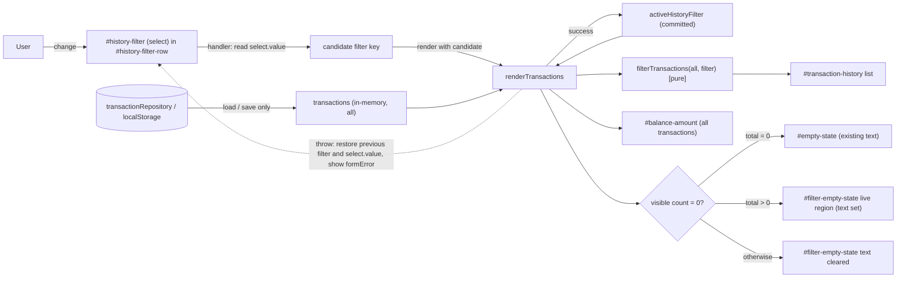

# Architecture: AG-10 Filter transactions by type

- Jira issue: AG-10, run ID AG-10-5, branch `feature/AG-10-5`
- Input: `requirements.md` (Approved by user, 2026-11-03); `design-review.md` (findings F-1..F-10)
- Status: **Approved (revision 2)** (user, 2026-11-03; see section 13). Not committed.
- The earlier Stage 2 approval (2026-11-03) applied to revision 1 only and does NOT cover this revised content. No approval is recorded for revision 2 (see section 13).

## Change log (revision 2)

Source: user instruction "update architecture.md" after Stage 3 design review. Items marked UNCONFIRMED are reviewer recommendations the user has not individually confirmed.

| Finding | Change | Sections |
|---------|--------|----------|
| F-1 | Added explicit wrapper `#history-filter-row`; load-failure hiding uses `showElement(wrapper, visible)` / existing `.hide` class, not a bare `hidden` attribute. `hidden` no longer used for any new element. | 3, 4, 6, 7 |
| F-2 | Commit-after-success: candidate filter is rendered first; `activeHistoryFilter` is committed only after a successful render; on failure the previous filter and `select.value` are restored and an error is shown via `formError`. `renderTransactions` gains an optional third parameter. | 3, 4, 6, 9 |
| F-3 (UNCONFIRMED) | `#filter-empty-state` is now an always-present `role="status"` live region; its `textContent` is set or cleared instead of toggling `hidden`. | 3, 4, 6, 9, 11 |
| F-4 | Filter label and select wrapped in `
` so existing `.field` / `.field select` styles apply. | 3, 4 |
| F-5 | Handler reads `historyFilterSelect.value` directly (never `event.target`), exactly one `change` listener inside a null guard; `createApp` and the markup test must add the new ids. | 3, 4, 9 |
| F-6 | Single rule: when `!repositoryReady` the handler returns without changing state. Section 7 wording replaced. | 4, 7 |
| F-7 (UNCONFIRMED) | Filter row stays visible whenever the repository is loaded, including when the history is empty. | 4, 7, 11 |
| F-8, F-9, F-10 | Noted as accepted by the design review (F-8 and F-10 recorded; F-10 optional normalisation of unknown value to `all`). No design change beyond AR-2 wording. | 6, 9 |

Unchanged and user-confirmed: labels (All / Income / Expenses, label "Show"), exact empty messages, D-1..D-6 intent, Q-A1..Q-A3 resolutions.

## 1. Verified repository facts (inspected)

- Static app, no framework or build: `index.html`, `script.js` (single classic script, top-level `const`/`let`), `styles.css`. Tests: `tests/app.test.cjs` (`node:test`, fake DOM via `vm`).
- `script.js` structure: pure helpers (`parseAmountToPaise`, `formatINR`, `calculateAvailableBalance`), `transactionRepository` (localStorage load/save, schema v1), DOM element lookups via `getElementById`, module state (`transactions`, `repositoryReady`, `isSaving`, `isLoading`), `createTransactionElement`, `renderTransactions(nextTransactions, balanceInPaise)`, `renderLoadFailure`, `loadTransactions`, submit handler, retry handler.
- `renderTransactions` builds a `.transaction-list`, sets the balance, and sets `emptyState.hidden = nextTransactions.length !== 0`. It is called from `loadTransactions` (initial and retry) and from the submit handler (after save).
- `renderLoadFailure` hides balance and `#empty-state`, clears history, and shows error plus retry.
- The test fake DOM (`FakeElement`) supports `addEventListener`/`dispatch(name)` (event object has only `prevented` and `preventDefault`, no `target`), `hidden`, `textContent`, `value`, `classList.toggle`, `append`, `replaceChildren`. `getElementById` returns `null` for ids not in the test `ids` list. There is no `querySelector`, `dataset`, or multi-handler support (one listener per event name).
- Two existing hiding mechanisms: the `hidden` attribute (`#empty-state`, `#balance-amount`) and the `.hide` class via `showElement` (errors, retry). `hidden` fails if author CSS sets `display` on the element.
- Existing styles: `.field`, `.field label`, `.field select` are descendant selectors scoped to `.field` (so they do not apply outside it); `#empty-state` is styled grey; `.hide` utility exists.
- CI configuration: Not Found.

## 2. Architecture overview

A view-layer-only change. Stored data, the repository, the schema, and balance logic are untouched. A single piece of in-memory UI state (the active filter) is applied inside the render path, so every existing re-render trigger (load, retry, add) automatically honours the filter.

Data-flow notes:
1. Load/retry/add produce the full `transactions` array exactly as today; filtering happens only at render time (FR-5).
2. Balance is computed from the full array and passed to render unchanged (FR-6).
3. The filter control never calls the repository.
4. The filter is committed to module state only after a successful render (F-2).

## 3. Components and responsibilities

| Component | Status | Responsibility | Requirements |
|-----------|--------|----------------|--------------|
| `index.html`: `
` inside `.history-card` containing `<label for="history-filter">` and `<select id="history-filter">`; plus always-present `
` (empty text) | Proposed (new markup) | Present the options All/Income/Expenses; host the filter-specific empty message as a live region. Row is visible by default. | FR-1, FR-4, FR-7, NFR-1 |
| `script.js`: `HISTORY_FILTERS` constant map | Proposed | Single source of truth mapping filter value to label-independent rule: `all -> null`, `income -> "Money Received"`, `expenses -> "Expense"`, plus empty message strings | FR-2, FR-3, FR-4 |
| `script.js`: `filterTransactions(list, filterKey)` pure function | Proposed | Return the matching subset without mutating or reordering; unknown key falls back to All | FR-2, FR-3, FR-5, A-9 |
| `script.js`: `activeHistoryFilter` state (default `"all"`) | Proposed | Hold the committed selection in memory only | FR-7, FR-8, A-7 |
| `script.js`: `renderTransactions(allTransactions, balanceInPaise, filterKey = activeHistoryFilter)` | Modified | Apply the filter to the list; set or clear `#filter-empty-state` text; keep balance from the full set. Builds list and message before mutating the DOM (build-then-swap) so a throw does not leave a half-rendered view. | FR-2..FR-6, NFR-4 |
| `script.js`: filter `change` handler | Proposed | Registered once, inside a null guard. If `!repositoryReady`, return without changing any state. Otherwise read `historyFilterSelect.value` directly (not `event.target`), normalise unknown value to `all`, recompute balance via `calculateAvailableBalance`, call `renderTransactions(transactions, balance, candidateKey)`, and only on success set `activeHistoryFilter = candidateKey`. On throw: keep previous `activeHistoryFilter`, restore `historyFilterSelect.value` to it, and show an error through the existing `formError`. | AC-2, AC-3, NFR-4 |
| `script.js`: `renderLoadFailure` | Modified (small) | Also hide `#history-filter-row` via `showElement(wrapper, false)` (`.hide`) and clear `#filter-empty-state` text | NFR-4 |
| `script.js`: successful render / retry path | Modified (small) | Show `#history-filter-row` via `showElement(wrapper, true)` after a successful render so visibility is restored after retry | NFR-4 |
| `script.js`: submit handler | Unchanged logic | Already re-renders via `renderTransactions`, which now applies the committed filter | FR-8 |
| `transactionRepository`, `calculateAvailableBalance`, validators | Unchanged | Persistence and balance | FR-5, FR-6 |
| `styles.css` | Modified (small) | `.field` wrapper reuses existing `.field`/`.field select` rules; a small `.history-filter` rule adjusts layout if the form-grid layout does not fit; style `#filter-empty-state` like `#empty-state`; `#filter-empty-state:empty` collapses spacing (margin/padding 0) without `display:none`, so the region stays in the accessibility tree. No `display` rule on any element that relies on `hidden`. | NFR-3 |
| `tests/app.test.cjs` | Modified | Add `history-filter`, `history-filter-row`, `filter-empty-state` to the `createApp` ids list and extend the markup test in step; tests set `elements["history-filter"].value` then `dispatch("change")`; add AC tests | NFR-5 |

## 4. Interfaces

- DOM contract (proposed ids): `#history-filter-row` (wrapper, `class="field history-filter"`, visible by default, hidden only through the `.hide` class), `#history-filter` (select, options `value="all"|"income"|"expenses"`, text "All"/"Income"/"Expenses", `all` selected by default, associated `<label for="history-filter">` with text "Show"), `#filter-empty-state` (`role="status"`, always rendered, empty text by default, no `hidden` attribute).
- Internal function contracts: `filterTransactions(transactions, filterKey) -> Transaction[]` (pure, key passed as parameter); `renderTransactions(allTransactions, balanceInPaise, filterKey = activeHistoryFilter)`. The first two parameters are unchanged, so existing call sites and tests are unaffected; only the filter handler passes the third argument.
- Render rules:
  - total = 0: show `#empty-state` (existing text), clear `#filter-empty-state` text, regardless of filter (FR-4 separation). The filter row stays visible (F-7, UNCONFIRMED).
  - total > 0, visible = 0: hide `#empty-state`; set `#filter-empty-state.textContent` to "No income transactions." or "No expense transactions.". (All can never yield visible = 0 when total > 0.)
  - visible > 0: hide `#empty-state`; clear `#filter-empty-state` text.
  - Load failure: history cleared, `#empty-state` hidden, `#filter-empty-state` text cleared, filter row hidden via `.hide`.
- Handler contract (F-2, F-5, F-6): `!repositoryReady` -> return, no state change. Otherwise read `select.value` -> candidate key (unknown -> `all`, select normalised to `all`) -> render with candidate -> on success commit `activeHistoryFilter`; on failure restore previous filter and `select.value` and report via `formError`. The text of that error message is proposed at implementation planning (not user-confirmed wording).
- Test seam: `filterTransactions` and the constants may be added to the `__appTest` export list in `createApp` (test-side change only).

## 5. Technology choices and alternatives

| Decision | Proposed | Rationale | Alternatives (not chosen) |
|----------|----------|-----------|---------------------------|
| Control type (A-8) | Native `<select>` | Matches the existing Type `<select>` and `.field select` styling; free keyboard and screen-reader support; label association is trivial; smallest markup and CSS; works with the fake DOM via `value`/`change` | Radio group / segmented buttons: better one-tap discoverability for 3 options and visible state, but needs fieldset/legend, `aria-pressed` or radio wiring, more CSS, and the fake DOM lacks `querySelectorAll`/`checked` so tests are heavier. Tabs: wrong semantics (no tab panels). |
| State handling | Module-level `let activeHistoryFilter`, default applied inside `renderTransactions`, committed after successful render | Matches the existing module-state pattern; every render path honours the filter; no new store | Filtering at each call site (duplication, risk of missed path); storing the filtered list as state (risk of divergence from `transactions`); persisting in localStorage/URL (out of scope, A-7). |
| Where to filter | At render time on the in-memory array | Keeps storage and `transactions` authoritative (FR-5); no extra I/O | Re-reading storage on every change (unnecessary, adds failure modes). |
| Filter keys | Internal keys (`all`/`income`/`expenses`) mapped to stored types in one constant | Decouples UI vocabulary from stored data and isolates the R-1 mismatch in one tested place | Using stored type strings as option values (leaks "Money Received" vs "Income" mismatch into markup). |
| Empty message | Separate element `#filter-empty-state`, always-present live region | Preserves the existing `#empty-state` element and text and its tests; easy to assert independently; live region reliably announces text changes (F-3, UNCONFIRMED) | Reusing `#empty-state` with swapped text (couples two meanings, risks breaking existing assertions and the "no empty message on load failure" rule). Toggling `hidden` on a `role="status"` element (inconsistent announcement). |
| Hiding the filter row | Wrapper `#history-filter-row` + `.hide` via `showElement` | `.hide` is a global `display:none` that is not defeated by a flex/grid row; consistent with how errors and retry are hidden (F-1) | Bare `hidden` attribute on a flex/grid row (can silently fail); `disabled` (control stays visible beside the error). |
| Styling | `.field` wrapper | Reuses existing `.field select` rules with no duplication (F-4) | Extending the rule with a `.history-filter select` selector (acceptable alternative if the `.field` form-grid layout proves unsuitable; decide at planning) |
| Dependencies | None added | NFR-3 | - |

## 6. Security, error handling, accessibility

- Security (NFR-2): all new text is set through `textContent`; no `innerHTML`; filter values are matched against a fixed whitelist map, never interpolated into DOM or selectors. Unknown/tampered `select.value` falls back to All (and the select is normalised to `all`, F-10). No new storage keys, network calls, or secrets. Trust boundary unchanged (localStorage contents are still validated by `isStoredTransaction`).
- Error handling (NFR-4): on load failure the filter row is hidden through `.hide` and `#filter-empty-state` text is cleared; the change handler is a no-op unless `repositoryReady`. The handler uses commit-after-success: any throw (including the `RangeError` from recomputing the balance, or an error in building rows) leaves `activeHistoryFilter` and the select at their previous values and shows an error through `formError`. `renderTransactions` builds the list and message before swapping them into the DOM so a throw leaves the prior view intact. After a successful retry the render path re-shows the row.
- Accessibility (NFR-1): visible `<label for>`; native keyboard operation; the history container is already `aria-live="polite"` so list changes are announced (and the whole list is re-announced on each change, existing behaviour amplified by the filter, accepted); `#filter-empty-state` is an always-present `role="status"` region whose text is set and cleared, which is more reliably announced than toggling visibility (F-3, UNCONFIRMED). Focus is not moved on change. Real screen-reader behaviour cannot be verified here; if no tooling exists, record manual screen-reader verification as a Stage 7 not-run item.
- Cross-cutting: after a filter change the stale "Transaction added." status is left untouched (cosmetic, see risks).

## 7. Failure scenarios and scalability

| Scenario | Behaviour |
|----------|-----------|
| Load fails (corrupt/denied storage) | Existing error and retry shown; filter row hidden via `.hide`; no empty message and `#filter-empty-state` text cleared (NFR-4) |
| Filter changed before repository ready | Handler returns without changing state (Q-A1: the row is hidden then, so this cannot occur through the UI). After a successful retry the filter is whatever was last committed (default All). |
| Render throws during a filter change | Previous filter and select value restored; error shown via `formError`; previous view retained |
| Empty history (total = 0) | Existing `#empty-state` shown; filter row remains visible; `#filter-empty-state` empty (F-7, UNCONFIRMED) |
| Add transaction under non-matching filter | Saved, balance updated, list unchanged, filter empty message shown if no matches (FR-8) |
| Save fails | Existing behaviour; filter unaffected |
| Large history | O(n) filter pass plus existing full re-render on each change; acceptable for a local single-user app; no virtualization proposed |

## 8. Dependencies

Internal only: `script.js` render path depends on `HISTORY_FILTERS`, `filterTransactions`, and new element lookups (`history-filter`, `history-filter-row`, `filter-empty-state`); tests depend on the new ids being added to `createApp` (otherwise `getElementById` returns null and new tests would silently not exercise anything). The script must null-guard the new elements (existing pattern, e.g. `if (transactionForm)`), which also keeps older test harness variants working. External: none.

## 9. Risks, trade-offs, assumptions

- R-1 (carried over, accepted): UI says "Income"/"Expenses" while the form says "Money Received"/"Expense". Mitigated by the central mapping and explicit tests.
- AR-1: The select hides options behind a click compared with a segmented control; accepted for consistency and simplicity (reversible, markup/CSS only).
- AR-2 (revised): `renderTransactions` has an implicit dependency on module state through the defaulted third parameter. Existing call sites are unchanged; only the filter handler overrides it to support commit-after-success (F-8 accepted).
- AR-3: Fake DOM supports a single listener per event name, so exactly one `change` handler is registered on the filter (matches existing style). The handler must not use `event.target`, because the fake event has no `target`; tests set `elements["history-filter"].value` then `dispatch("change")` (F-5).
- AR-4: Stale "Transaction added." message may remain after switching filters; cosmetic, not in requirements (F-9, Q-A3).
- AR-5: Hiding versus disabling the filter on load failure is unspecified by requirements; decision is hide (consistent with balance being hidden), implemented with `.hide` on the wrapper.
- AR-6 (new): Screen-reader announcement of the live region cannot be verified without a browser or assistive technology; manual verification may be a Stage 7 not-run item.
- AR-7 (new): Wording of the filter-failure error shown via `formError` is not user-confirmed; to be proposed at planning.
- Assumption: the existing display order (insertion order) is preserved (A-9).

## 10. Traceability

| Requirement / AC | Architecture element | Verification (per NFR-5) |
|------------------|----------------------|--------------------------|
| AC-1, FR-1, FR-7, NFR-1 | `#history-filter` select in `#history-filter-row`, three options, default `all`, label "Show" | Markup test on `index.html` options and label; default value; ids present in `createApp` |
| AC-2, FR-2, FR-5, FR-8 | `HISTORY_FILTERS`, `filterTransactions`, change handler, `renderTransactions` | Seed mixed data; set select value and dispatch `change`; Income shows only Money Received; Expenses only Expense; storage JSON unchanged; add under filter keeps filter |
| AC-3, FR-3 | `all` rule returns full list | Switch back to All shows all items |
| AC-4, FR-4, NFR-4 | `#filter-empty-state` rules in section 4 | Exact strings; original message only when total = 0; `#filter-empty-state` text empty on load failure and when matches exist; filter row has `.hide` on load failure and is shown again after retry |
| FR-6 | Balance from full array | Balance text identical across filters |
| NFR-2 | `textContent` only, whitelist map | Existing markup-note test still passes under each filter |
| NFR-3 | No deps, existing patterns | Review |
| NFR-4 (handler failure) | Commit-after-success handler | Force a render throw; assert previous filter and select value restored and `formError` shown |
| NFR-5 | Test changes in `tests/app.test.cjs` | `node --test tests/` full suite |

## 11. Decisions, assumptions, and unresolved questions

Decisions (D-1..D-6 intent unchanged; the Stage 2 approval covered revision 1 only):
- D-1 native select.
- D-2 module state plus render-time filtering (now commit-after-success, F-2).
- D-3 internal filter keys mapped centrally.
- D-4 separate `#filter-empty-state`.
- D-5 hide filter on load failure (now specified as wrapper `#history-filter-row` plus `.hide`, F-1).
- D-6 `role="status"` on the filter empty message (now an always-present live region, F-3, UNCONFIRMED).

Decisions from design-review proposals, user-directed in revision 2: F-1, F-2, F-4, F-5, F-6.

UNCONFIRMED (reviewer recommendations not individually confirmed by the user): F-3 always-present live region; F-7 filter visible when the history is empty. F-8, F-9, F-10 recorded as accepted per the design review.

Resolved questions (unchanged):
- RESOLVED (user-accepted proposal) Q-A1: Filter change while the repository is not ready: the control is hidden then, so the case does not arise; the handler returns without changing state.
- RESOLVED (user-accepted proposal) Q-A2: Visible label text "Show".
- RESOLVED (user-accepted proposal) Q-A3: Stale "Transaction added." status left as is on filter change.

Open: confirmation or override of F-3 and F-7; wording of the filter-failure error (AR-7).

## 12. Verification of this revision

Checked against `requirements.md` ACs and the design-review findings by reading both source documents; no source or test files were modified or executed. Real-browser and screen-reader behaviour are not verified.

## 13. Approval

Status: **Approved (revision 2)**. Approval evidence: User message in main session, 2026-11-03: "Approve al" (truncated; orchestrator interpretation: approves architecture.md revision 2, the focused re-review, F-3 and F-7 as recommended, N-1/N-2/N-3/N-5 as impl-plan constraints, N-4 accepted with manual screen-reader check recorded as a Stage 7 not-run item; AR-7 formError wording deferred to planning). The message is ambiguous, so it is NOT authorization to commit, push, or start Stage 4. F-3 and F-7 are now confirmed as recommended by that interpretation. N-1, N-2, N-3 and N-5 are carried as impl-plan constraints; this document is unchanged by them. AR-7 remains open.
