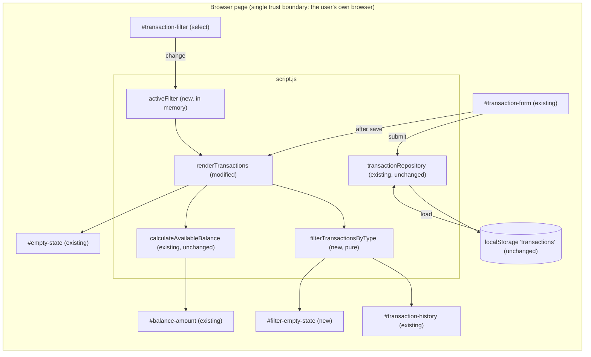

# Architecture: AG-10 Filter transactions by type

Status: Awaiting Approval (DRAFT, not approved)
Stage: 2 - Architecture Design
Branch: feature/AG-10-1
Input: approved `requirements.md` (Stage 1 approved by the user; A-001..A-006 stand as written; Q-001..Q-007 were not answered and are carried forward in section 11 as design decisions with a recommended default).

## 1. Summary

Add a client-side, display-only filter to the transaction history of the existing static vanilla HTML/CSS/JS app. The change is small and has four parts:

1. A labelled native `<select id="transaction-filter">` (All / Income / Expenses) in the history card.
2. One in-memory variable, `activeFilter`, defaulting to `"all"`.
3. One pure function, `filterTransactionsByType(transactions, filter)`, in `script.js`.
4. `renderTransactions` renders the filtered list. The balance continues to come from the full list. A new element, `#filter-empty-state`, handles the filtered-empty case. The existing `#empty-state` keeps its meaning of "no transactions at all".

No new files, dependencies, storage keys, or schema changes. No new external integrations (Not Applicable).

## 2. Verified Existing Components (repository evidence)

| Component | Location | Relevance |
|---|---|---|
| Static page, no build system or `package.json` | `index.html`, `script.js`, `styles.css` | Stack is vanilla; the solution must be too |
| `TRANSACTION_TYPES = ["Expense","Money Received"]` | `script.js:3` | Only income/expense discriminator |
| `calculateAvailableBalance(transactions)` | `script.js:39` | Pure; must keep receiving the full list |
| `renderTransactions(nextTransactions, balanceInPaise)` | `script.js:387` | Rebuilds `#transaction-history`, sets balance, toggles `#empty-state`; called from `loadTransactions` (l.424) and the submit handler (l.511) |
| `renderLoadFailure` | `script.js:400` | Hides `#empty-state`, clears history, disables submit |
| `showElement(el, visible)` and `.hide` class; `hidden` attribute | `script.js:294` | Existing visibility conventions |
| Module state: `let transactions`, `repositoryReady`, `isSaving`, `isLoading` | `script.js:289` | Place for `activeFilter` |
| `#empty-state` (`hidden`, static text) and `#transaction-history` (`aria-live="polite"`) | `index.html:100-103` | Existing empty/history regions |
| `.field` + `label` + `select` pattern; `#empty-state` styling; `.hide` | `index.html:33-45`, `styles.css` | Reuse for look and feel |
| Test harness: `node:test`, `vm`, `FakeElement`, two ID lists (HTML check l.174, `createApp` l.115), `__appTest` export list (l.153) | `tests/app.test.cjs` | Needs extending (section 8) |

Not Found: CI configuration, documented test command (assumed `node --test tests/`, Not Verified), any prior filter code. `docs/` contains only Codemie analytics JSON and has no architecture documentation to update.

## 3. Proposed Design

### 3.1 Component diagram



### 3.2 Data flow

```mermaid
sequenceDiagram
  participant U as User
  participant S as #transaction-filter
  participant H as change handler
  participant R as renderTransactions
  participant F as filterTransactionsByType
  U->>S: choose Income
  S->>H: change event
  H->>H: activeFilter = validated value (fallback "all")
  H->>R: render(transactions (full), balance of full list)
  R->>F: filter(full list, activeFilter)
  F-->>R: visible list (same order, same objects)
  R->>R: render visible items; balance from full list
  R->>R: empty-state if full list empty; filter-empty-state if full non-empty and visible empty
```

Storage is untouched on filter change. The filter never writes to `localStorage`.

### 3.3 Filter control: placement and markup

Inside the history `<section>`, directly after the `<h2 id="history-heading">`:

```html
<div class="field history-filter">
  <label for="transaction-filter">Show</label>
  <select id="transaction-filter" name="filter">
    <option value="all">All</option>
    <option value="income">Income</option>
    <option value="expenses">Expenses</option>
  </select>
</div>
```

Placed after the heading and outside `<form id="transaction-form">`, so `transactionForm.reset()` does not reset it (needed for Q-004 default). Option values are internal keys. Visible labels follow Jira (A-001, FR-001).

Filtered-empty element, next to `#empty-state`:

```html
<p id="filter-empty-state" role="status" hidden></p>
```

Its text is set with `textContent` at render time. The visible filter label is the source of the wording, for example "No income transactions found." / "No expense transactions found." (pending Q-002).

### 3.4 Filter state

`let activeFilter = "all";` next to the other module state. It is session-only (A-004) and is not persisted. The change handler reads `transactionFilter.value`, accepts it only if it is a known key, otherwise uses `"all"`. This defends against unexpected values.

### 3.5 Pure filter function and where it lives

In `script.js`, alongside the other pure helpers (near `calculateAvailableBalance`). No new module, since the app is a single classic script and the tests load `script.js` via `vm`.

```js
const FILTER_TYPE_BY_KEY = { income: "Money Received", expenses: "Expense" };

const filterTransactionsByType = (transactions, filter) =>
  filter in FILTER_TYPE_BY_KEY   // own-key check preferred; plan stage to finalise
    ? transactions.filter(({ type }) => type === FILTER_TYPE_BY_KEY[filter])
    : transactions;               // "all" and unknown keys: full list
```

(Illustrative signature and contract only; not implementation.) Contract: pure, no mutation, preserves order (A-005), unknown or "all" returns the full list, returns a new or the same array but never mutates input. The mapping constant is the single place that implements A-001.

### 3.6 Render integration

`renderTransactions(nextTransactions, balanceInPaise)` keeps its signature. Callers still pass the full list and the full-list balance. Internally it:

1. Computes `visible = filterTransactionsByType(nextTransactions, activeFilter)`.
2. Renders `visible` into the list (existing `createTransactionElement`).
3. Sets the balance from `balanceInPaise` (unchanged, EC-006).
4. `emptyState.hidden = nextTransactions.length !== 0` (unchanged meaning).
5. Filtered-empty: shown when `nextTransactions.length > 0 && visible.length === 0`, with text for the active filter; hidden otherwise.

Keeping the signature means the existing two call sites and the existing tests need no semantic change.

Change handler (new, guarded like the form handler): if `!repositoryReady` return; set `activeFilter`; call `renderTransactions(transactions, calculateAvailableBalance(transactions))` inside try/catch. Recomputing the balance is cheap and keeps one render path. On failure, show the existing `setFormError`-style message rather than failing silently (the exact wording is a plan-stage detail).

`renderLoadFailure` additionally hides `#filter-empty-state` and disables the select (`transactionFilter.disabled = true`), preserving EC-004. `loadTransactions` success path re-enables it.

### 3.7 Add-while-filtered (EC-003, Q-004)

Recommended default: keep the active filter after a successful add; the new item is shown only if it matches. To avoid the user thinking the save failed, the success message may become "Transaction added." plus a note when the new transaction is hidden by the filter (for example "Transaction added. It is hidden by the current filter."). This extra message is optional and listed as D-004 for the user to decide. Alternative: reset to All.

### 3.8 Balance unaffected

`calculateAvailableBalance` is called only with the full list, in `loadTransactions`, the submit handler, and the new change handler. The filter function is never applied before balance calculation (BR-004, EC-006).

### 3.9 Accessibility (NFR-001)

- Native `<select>` with a visible `<label for>`: keyboard operable, screen-reader friendly, same pattern as `#transaction-type`.
- Apply on `change` (A-006, no apply button).
- Filtered-empty message uses `role="status"` so it is announced; the list container keeps `aria-live="polite"`.
- Reuses `.field select` focus styles. Add only minimal CSS: group `#filter-empty-state` with the `#empty-state` rule, and a small spacing rule for `.history-filter`.

### 3.10 Security (NFR-002)

All new dynamic text uses `textContent`. The filter value is validated against a fixed key set. No new data, storage, network, or secrets. Trust boundary unchanged (single user, local browser).

## 4. Alternatives Considered

| # | Option | Pros | Cons | Decision |
|---|---|---|---|---|
| A | Native `<select>` (chosen) | Mirrors existing `#transaction-type`; accessible; fakeable in tests with `.value` + `dispatch("change")`; minimal CSS | Two clicks to switch | Chosen |
| B | Radio group in `<fieldset>` | One-click switch; clear current state | More markup/CSS; fake DOM needs per-radio handling (`checked`) | Rejected (cost, no requirement) |
| C | Button/tab group with `aria-pressed` | Familiar UI | Most markup, state sync, and CSS; more test stub work | Rejected |
| D | Reuse `#empty-state` with dynamic text | One fewer element | Overloads two meanings; existing tests assert its semantics for the true-empty case | Rejected in favour of separate element |
| E | Filter inside `renderTransactions` (chosen) vs callers pre-filtering | Single render path; both call sites get it for free | Function now has a hidden dependency on module state `activeFilter` | Chosen; matches existing style where render reads module elements. Alternative of passing the filter as a third parameter is acceptable if the planner prefers explicitness |
| F | Hide non-matching DOM nodes with CSS instead of re-rendering | No re-render | Splits logic into DOM/CSS, breaks `replaceChildren` model, harder to test | Rejected |
| G | Persist filter in `localStorage` | Survives reload | Contradicts A-004; touches storage | Rejected (Q-006 default) |
| H | Extract to a separate module/file | Cleaner separation | No module system or build; test harness reads only `script.js` | Rejected |

## 5. Failure Scenarios

| Scenario | Behaviour |
|---|---|
| Storage load fails (EC-004) | Existing error and retry shown; filter disabled; neither empty message shown |
| Unexpected select value | Treated as "all" |
| Filter yields nothing but data exists (EC-001) | `#filter-empty-state` shown; `#empty-state` hidden |
| No data at all (EC-002) | Existing `#empty-state` shown regardless of filter; filter-empty hidden |
| Render throws on filter change | Caught; visible error message; stored data unchanged |
| Legacy migrated data (EC-005) | All are "Expense"; shown under Expenses |

## 6. Scalability and Performance

In-memory list, a single O(n) `Array.filter` per interaction, full re-render as today. No target specified (NFR-003); no concern at the expected scale. Not Applicable: pagination, caching, server scaling.

## 7. Files Expected to Change (for the later planning stage; not changed now)

| File | Change |
|---|---|
| `index.html` | Add filter markup and `#filter-empty-state` |
| `script.js` | Constants/pure function, `activeFilter`, element lookups, `renderTransactions` change, `renderLoadFailure` addition, change handler |
| `styles.css` | Small additions (spacing, grouped empty-state style) |
| `tests/app.test.cjs` | Stub and new tests (section 8) |

## 8. Test Impact (`tests/app.test.cjs`)

Existing tests will fail or hit null elements unless the stub is extended:

1. Add `"transaction-filter"` and `"filter-empty-state"` to the `ids` list in `createApp` (otherwise `getElementById` returns null and unguarded code throws).
2. Add the same IDs to the HTML-presence list in the integration test at l.174.
3. Set `elements["transaction-filter"].value = "all"` in `createApp`, as is done for `transaction-type`.
4. Add `filterTransactionsByType` to the `__appTest` export snippet.
5. `FakeElement.reset()` needs no change (filter is outside the form); the stub's single-listener `addEventListener` is sufficient for one `change` handler.

New tests to be defined at planning (NFR-004), covering:
- Unit: `filterTransactionsByType` for all/income/expenses/unknown; order preserved; input not mutated.
- Integration: FR-001 (markup has three options, label), FR-002 (select Income shows only "Money Received"; Expenses shows only "Expense"), FR-003 (back to All shows full), FR-004/EC-001 (filtered-empty text, `#empty-state` hidden), EC-002 (no data: only `#empty-state`), EC-003 (add while filtered), EC-004 (load failure: neither message, filter disabled), EC-005 (legacy rows under Expenses), EC-006 (balance text unchanged across filter changes), storage unchanged on filter change, existing literal-text note test still passes.

Existing tests are expected to continue to pass with the stub additions. This is Not Verified until implementation.

## 9. Requirement-to-Component Traceability

| Requirement / AC | Component(s) | Notes |
|---|---|---|
| FR-001 / AC-001 | `#transaction-filter` markup with label and 3 options (3.3) | Labels per A-001 |
| FR-002 / AC-002, BR-001, BR-002 | `FILTER_TYPE_BY_KEY`, `filterTransactionsByType`, `renderTransactions` (3.5, 3.6) | |
| FR-003 / AC-003 | `filterTransactionsByType` returns full list for "all"; change handler | |
| FR-004 / AC-004 | `#filter-empty-state` + render logic (3.3, 3.6) | Text pending Q-002 |
| BR-003 / A-002 | `activeFilter = "all"`, `selected` default option | |
| BR-004 / A-003, EC-006 | Balance computed from full list only (3.8) | |
| A-004 | In-memory `activeFilter`, no storage | |
| A-005 | Filter preserves order | |
| A-006 | `change` event handler | |
| EC-001 | `#filter-empty-state` | |
| EC-002 | Existing `#empty-state` unchanged | |
| EC-003 | Handler keeps filter after add (3.7) | D-004 |
| EC-004 | `renderLoadFailure` update (3.6) | |
| EC-005 | Mapping A-001 | |
| NFR-001 | Native labelled select, `role="status"` (3.9) | |
| NFR-002 | `textContent`, key validation (3.10) | |
| NFR-003 | O(n) filter (section 6) | |
| NFR-004 | Test plan (section 8) | |

## 10. Risks

| ID | Risk | Mitigation |
|---|---|---|
| R-1 | Terminology mismatch (Income/Expenses vs Money Received/Expense) confuses users | Single mapping constant; labels per Jira; confirm Q-001 |
| R-2 | Filtered-empty vs true-empty confusion | Separate elements with mutually exclusive rules, tested |
| R-3 | Test stub missing new IDs breaks the entire suite via null elements | Update both ID lists first; run full suite |
| R-4 | `renderTransactions` reading module-level `activeFilter` is an implicit dependency | Documented; passing a parameter is an acceptable alternative |
| R-5 | Added item hidden by active filter looks like a failed save | D-004 message or reset-to-All |
| R-6 | No git baseline (no commits) and no CI; test command unverified | Report actual test output at Verification |
| R-7 | Filter control left enabled during load failure would allow render on empty state | Disable on failure plus `repositoryReady` guard |

## 11. Design Decisions, Assumptions, Open Questions

Decisions (proposed, pending approval):
- D-001: Native `<select>` in the history card (section 3.3).
- D-002: Pure `filterTransactionsByType` in `script.js` with a single mapping constant.
- D-003: `renderTransactions` signature unchanged; filtering inside; balance from full list.
- D-004 (Q-004): keep filter after add; optional "hidden by the current filter" note. Needs user choice.
- D-005 (Q-002): separate `#filter-empty-state`, default text "No income transactions found." / "No expense transactions found."; existing text unchanged for no-data case.
- D-006: Disable filter on load failure.

Assumptions: A-001..A-006 as written in requirements. No new assumptions about Jira content. Existing line numbers are from the current untracked working tree.

Carried-forward questions with recommended defaults:

| Q | Recommended default | Where in design |
|---|---|---|
| Q-001 labels | All / Income / Expenses (Jira), mapped | 3.3, 3.5 |
| Q-002 empty text | Per-filter text above; true-empty text unchanged | 3.3 |
| Q-003 default | All | 3.4 |
| Q-004 add while filtered | Keep filter; optional hidden note | 3.7 |
| Q-005 balance | Full-list balance always | 3.8 |
| Q-006 persistence | No | 3.4 |
| Q-007 other filters/sort | Out of scope | - |

## 12. Approval Status

- Stage status: Awaiting Approval
- Approval: Pending
- Approval evidence: None recorded for this stage
- Nothing in this document has been approved by a human.
